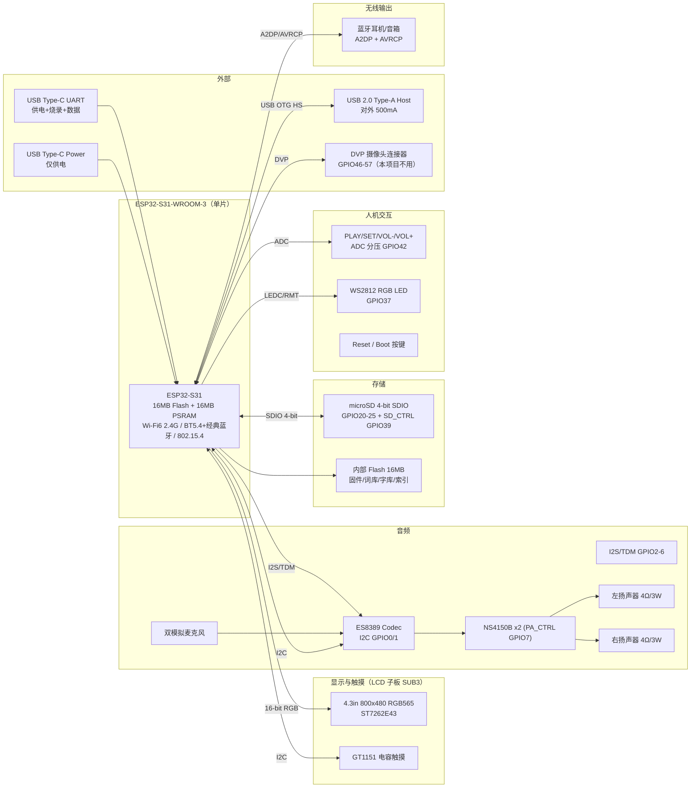

# ESP32-S31-Korvo-1 流媒体音乐播放器 开发指南

> 目标硬件：**ESP32-S31-Korvo-1 V1.1**（模组 ESP32-S31-WROOM-3：2.4 GHz Wi-Fi 6 + 蓝牙 5.4 / 经典蓝牙 + IEEE 802.15.4；16 MB SPI Flash + 16 MB PSRAM）
> 屏幕：**4.3 英寸 800 × 480 RGB565 触摸屏**（LCD 子板 ESP32-S3-LCD-EV-Board-SUB3，面板驱动 ST7262E43，触摸 GT1151）—— **默认横屏**
> 音频：**ES8389 双声道 Codec**（I2S + I2C）+ **2 × NS4150B 3 W D 类功放**（左/右声道）；蓝牙输出走**片内经典蓝牙 A2DP**
> 本地存储：板载 **microSD（4-bit SDIO 3.0，GPIO20~GPIO25）**
> 软件基线：**ESP-IDF 6.1**（`esp32s31` 为 preview target）+ **LVGL 9.5** + **esp_board_manager** + **ESP-GMF**
> 文档版本：v3.0 —— 目标板由 Metalio Claw4 迁移至 **ESP32-S31-Korvo-1**：删除 P4+C5 双芯 / 4G / GPS / 电池与电量计 / 外挂蓝牙音频模块等已作废方案，新增拼音输入法、横屏自适应与旋转配置
> 系统调度：Core 0 固定 LVGL/UI，Core 1 固定 Audio pipeline + Decoder；Wi-Fi/SD/BT 不强行绑核；LCD/I2S/PPA/2D-DMA 尽量硬件异步。

---

## 0. 先读这一节：五个必须先确认的设计前提

本节决定硬件选型与验收标准，请在动手写代码前读完。

> **开发纪律：编程开发时严格参考官方文档 —— https://docs.espressif.com/projects/esp-idf/zh_CN/latest/esp32s31/index.html**
>
> 本指南是"针对本项目的裁剪与补充"，**不能替代官方文档**。凡是官方文档有明确写法的，一律以官方为准：
>
> - 芯片与模组规格、外设能力、时钟与电源域，以 [ESP32-S31 / ESP-IDF 官方文档](https://docs.espressif.com/projects/esp-idf/zh_CN/latest/esp32s31/index.html) 为准
> - 驱动与外设 API（`esp_lcd`、`esp_driver_i2s`、`sdmmc`、`esp_wifi`、`esp_bt` 等）的**函数签名、Kconfig 名称、默认值**，以官方 API 参考与 `menuconfig` 为准
> - `idf.py` 的用法、target 设置、分区表规则、OTA 流程，以官方 "API 参考 / 迁移指南" 为准
> - 本指南与官方文档**冲突时以官方为准**；若发现冲突，请回到文档中修正本指南，而不是沿用本指南的旧写法
> - 本项目仍处于 IDF 6.1 的 **preview target** 阶段，API 与 Kconfig 可能变动 —— **写代码前先查当版官方文档**，不要凭记忆或凭旧版本经验下手
>
> 同理，板级外设（LCD / 触摸 / ES8389 / 按键 / RGB LED）的初始化严格参考 `esp_board_manager` 与官方 `factory_demo`；拼音输入法严格参考 `lvgl_pinyin_ime` 的 `docs/integration.md` 与 `docs/usage.md`。

### 0.1 单芯片：联网、经典蓝牙、802.15.4 全部在片内

Korvo-1 上只有一颗芯片，**不存在协处理器**：

| 角色 | 承载者 | 与本播放器的关系 |
| --- | --- | --- |
| 主控 / 应用 / UI / 解码 | **ESP32-S31** | 音乐播放的所有代码都跑在这里 |
| 网络通道 | **ESP32-S31 片内 2.4 GHz Wi-Fi 6** | 在线音乐的 HTTP(S) 请求 |
| 蓝牙音频 | **ESP32-S31 片内经典蓝牙（BR/EDR）** | A2DP 推流给耳机 / 音箱 |
| 低功耗无线 | ESP32-S31 片内 BLE 5.4 / 802.15.4 | 本项目不使用（BLE 可用于配网） |

因此：

- **没有 ESP32-P4 / ESP32-C5 双芯，没有 ESP-Hosted，没有 SDIO 协处理器固件**——旧文档里"改 P4 引脚必须同步重烧 C5"这类内容全部作废
- Wi-Fi 只有 **2.4 GHz**（模组为 2.4 GHz Wi-Fi 6），**不要写 5 GHz 双频**
- Wi-Fi 与经典蓝牙共用 2.4 GHz 射频，**必须开启射频共存**（`CONFIG_SW_COEXIST_ENABLE=y`），否则蓝牙播歌时 Wi-Fi 吞吐会崩
- 蓝牙耳机/音箱是**片内 A2DP 直连**，不要再写"外挂蓝牙音频模块 + UART AT 指令 + BT_POWER 电源位"

### 0.2 音频只有一路 Codec，但有两条逻辑通路

Korvo-1 的音频链路是"ES8389 → 双 NS4150B → 左右扬声器"：

| 项 | 实际情况 |
| --- | --- |
| Codec | **ES8389**（双通道 ADC + 双通道 DAC + 低噪前置放大 + 耳机驱动 + 数字音效 + 模拟混音） |
| 控制总线 | `I2C`：SDA=GPIO0 / SCL=GPIO1 |
| 数据总线 | `I2S`：MCLK=GPIO2 / SCLK=GPIO3 / LRCLK=GPIO4 / SDOUT=GPIO5 / DSIN=GPIO6 |
| 功放 | 左/右各一颗 **NS4150B**（3 W 单声道 D 类），由 **PA_CTRL=GPIO7 同时使能** |
| 输出 | 左右扬声器输出端口（4 Ω / 3 W，2.00 mm 间距），板载 **无 3.5 mm 耳机座** |
| 输入 | 左右板载模拟麦克风（双麦阵列） |
| 供电 | 音频电路有**独立 5 V → 3.3 V LDO**，与数字电路物理隔离 |

三条必须记住的结论：

1. **DAC 与 ADC 的信号都必须以 TDM 格式与 SoC 传输**，且 ES8389 的 Pin 4（MCLK）可通过寄存器复用为 `TDMIN`。**不要按"标准 I2S 立体声"直接写寄存器序列**，一律走 `esp_board_manager` / 官方 BSP 的 ES8389 配置
2. `PA_CTRL` 是**左右功放共用的一个使能脚**，没有分声道开关。切输出、防爆音都要动它
3. 播放与录音（双麦）走同一组 I2S/TDM 链路 → **播放时不能录音**，本项目录音只服务于可选的语音唤醒，与播放互斥

### 0.3 microSD 是板载 4-bit SDIO，不是 SPI，也不是外接模块

| 项目 | Korvo-1 实际情况 |
| --- | --- |
| 卡槽 | **板载 microSD 卡槽**，支持 4-bit 模式，**SDIO 3.0** 协议 |
| 数据/时钟 | DATA0~DATA3 = GPIO20~GPIO23，CLK = GPIO24，CMD = GPIO25 |
| 供电/开关 | **`SD_CTRL` = GPIO39**（microSD 电源/开关控制，同时是 Boot Mode 1） |
| 复用 | SPI NAND Flash 复用 GPIO20~GPIO25，**默认不上件**，要切换到 NAND 需改焊主板背面一堆电阻 |
| 文件系统 | FATFS（必须开长文件名） |

结论：

- SDIO 4-bit 带宽远高于 SPI，高码率 FLAC 读取、封面读取都更从容
- **不要写"外接 SPI SD 模块 / 扩展排针 / 占 4 个 GPIO"**
- **不要写"切到 SPI NAND 存音乐"**：默认不焊，且本项目所有音乐都放 SD 卡
- `SD_CTRL` 可用于息屏时切断卡供电降耗，但**唤醒后必须重新挂载**（详见 5.10、5.15）

### 0.4 屏幕是 RGB 接口横屏，旋转能力有限，UI 必须自适应宽高

- 物理分辨率 **800 × 480**，RGB565，**16 位并口**（DB0~DB15），配 **GT1151** 电容触摸
- LCD 控制信号脚位：`LCD_CS`=GPIO38、`LCD_PCLK`=GPIO40、`LCD_H_EN`=GPIO43、`LCD_H_SYNC`=GPIO44、`LCD_V_SYNC`=GPIO45、`LCD_MOSI`=GPIO60、`LCD_SCK`=GPIO61
- **这些脚同时是 Boot Mode 0~4 的 strapping 引脚**（GPIO38/39/40/60/61）→ 官方子板已按规范处理，**板上不要另接电路去拉这些脚**

关于旋转（本项目核心约束）：

| 旋转 | 可行性 | 代价 |
| --- | --- | --- |
| 0°（横屏，默认） | 直接可用 | — |
| 180° | 面板参数或 LVGL 旋转 | 小 |
| 90° / 270°（竖屏） | **RGB 面板无硬件旋转**，只能软件旋转 | 每帧 800 × 480 × 2 = **750 KB** 额外内存搬运，必须实测帧率 |

所以本项目的规定是：

1. **先按 0° 横屏把 UI 做完**，旋转作为**编译期开关**后期验证（见 5.2、5.4）
2. UI **禁止硬编码 800/480 与绝对坐标**，一律走 `UI_W` / `UI_H` 与百分比，保证换方向后能重排
3. 目标帧率 40 fps 以上；开软件旋转后若掉到 30 fps 以下，宁可降帧也不要关掉音频

### 0.5 无电池、无电量计：供电口径要整体改写

Korvo-1 是 **USB 5 V 供电的桌面/台面设备**，没有电池、没有充电管理、没有电量计：

| 项目 | 实际情况 |
| --- | --- |
| 供电口 | 两个 USB Type-C：**Power 口仅供电**，**UART 口供电 + 数据 + 烧录** |
| 供电能力 | 外接大功率喇叭并同时用 **USB Type-A 口对外供电**时，**总输入电流需满足 3 A** |
| 对外供电 | USB 2.0 Type-A 为 Host 口（芯片 USB 2.0 OTG High-Speed），对外最高 500 mA |
| 开关机 | **硬件拨动式电源开关**，没有软关机、没有电源按键 |
| 音频供电 | 音频电路有独立 LDO，降低数字噪声对音频的干扰 |

因此：

- **删除**电量百分比、充电图标、低电提醒、续航估算、浅睡 / 深睡等一整套电池相关功能
- **删除**"长按电源键关机 / 发关机脉冲 / 关机前保存状态"这类设计——拨动开关是**瞬时断电**，软件拿不到关机通知
- 状态栏不要画电池图标，改为「供电 / 存储卡 / 网络 / 蓝牙 / 输出通道」这一组图标
- 省电策略改名为**降耗策略**：息屏关背光、降 LVGL 帧率、Wi-Fi 省电模式、不用蓝牙时关蓝牙控制器（见 5.15）
- **电流与热**成为第一约束：双 3 W 喇叭大音量 + SD 写入 + Wi-Fi 发射是会拉垮 5 V 电源的组合

---

## 1. 项目概述

### 1.1 产品定位

一台运行在 ESP32-S31-Korvo-1 上的**网络流媒体音乐播放器**，定位介于"触屏随身听"与"桌面智能音频终端"之间：

- **内容来源**
  - 自部署 **Meting API**（`https://meting.xcnahida.cn/meting/`）转发的网易云 / QQ / 酷狗 / 百度音乐：搜索、歌单、直链、歌词、封面
  - **板载 microSD** 上的本地音乐库（4-bit SDIO + FATFS）
- **输出通道**
  - 板载 `ES8389 → NS4150B ×2 → 左/右扬声器`（本地外放，立体声）
  - **片内经典蓝牙 A2DP** → 蓝牙耳机 / 蓝牙音箱
- **交互**：4.3 英寸 800 × 480 触摸屏（GT1151）+ **自研拼音输入法**（歌曲名搜索）+ 板载 PLAY/SET/VOL-/VOL+ 实体按键 + 手势导航
- **联网**：片内 2.4 GHz Wi-Fi 6
- **供电**：USB 5 V（Power 口 / UART 口均可供电）

### 1.2 功能清单（验收 Checklist）

**A. 系统与启动**
- [ ] 上电自检：屏幕与触摸初始化、microSD 挂载、ES8389 就绪并保持静音
- [ ] 启动动画，SD 卡未插 / 未挂载仍可进系统（仅在线音乐可用）
- [ ] 首次开机进入配网引导（BLE 配网或 SoftAP，也可屏幕输入密码）
- [ ] 冷启动到首页可交互 < 3 s（不含网络）
- [ ] 编译期可选屏幕旋转方向（0/90/180/270），默认 0° 横屏

**B. 首页 / 桌面**
- [ ] 大字号时钟，小字日期与星期
- [ ] APP 图标网格（横屏 4 列 × 2 行），代码层模块化增删（见 5.8）
- [ ] 图标网格可翻页
- [ ] 深色壁纸

**C. 状态栏（常驻，高 32 px）**
- [ ] 时钟、Wi-Fi 信号强度（0~4 格）、蓝牙状态、输出通道图标、microSD 状态
- [ ] **不显示电量**（无电池）
- [ ] 任何界面、任何 APP 内可见（含全屏播放页）
- [ ] 状态变化有轻量动画，不阻塞 UI

**D. 控制中心（下拉，iOS 控制中心风格药丸布局，横屏适配）**
- [ ] 左「连接模块」药丸：2 × 2 圆形按钮（Wi-Fi、蓝牙、输出通道、静音）
- [ ] 右「媒体」药丸：封面 + 歌名/歌手 + 播放暂停；下方两个小药丸（输出通道、存储卡状态）
- [ ] 两个**横向**药丸滑条：亮度、音量（横屏下由纵向改为横向，圆角胶囊，填充自左向右）
- [ ] 底部一排圆形快捷按钮：主界面、在线搜索、设置、息屏
- [ ] 亮度 / 音量支持点按跳转与按住拖动
- [ ] 音量归零自动静音；蓝牙输出时同步绝对音量（对端支持时）
- [ ] 每次打开重新渲染，反映最新状态

**E. 手势导航（横屏版）**
- [ ] 左边缘右滑返回（跟手位移 + 底层页面视差）
- [ ] **右边缘左滑**打开功能抽屉（抽屉自右侧推入，宽 280 px）
- [ ] 顶部下拉控制中心；底部上滑回主页
- [ ] 松手按位移比例 + 速度判决提交或回弹
- [ ] 首页右滑阻尼反馈

**F. 音乐 APP**
- [ ] 播放器页（横屏左右分栏）：左封面、右歌名/歌手/歌词/进度/控制
- [ ] 封面读取 ID3 元数据：MP3 的 ID3v2 `APIC` / FLAC 的 `PICTURE` 块 / OGG 的 `METADATA_BLOCK_PICTURE` / 在线曲目取 `pic`
- [ ] 轻点封面在「封面 / 歌词」间切换（同一区域内交叉淡入）
- [ ] 歌词：LRC 解析 + 逐行高亮 + 当前行居中；无歌词时空状态提示
- [ ] 歌词优先级：本地同名 `.lrc` 边文件 → 内嵌歌词（ID3 `USLT` / Vorbis `LYRICS`）→ Meting 响应的 `lrc` 字段
- [ ] 播放模式：顺序 / 单曲循环 / 列表循环 / 随机
- [ ] 播放队列：点击跳播、拖动排序、滑动删除
- [ ] 列表页：本地音乐（按文件夹/歌手/专辑分组）、在线歌单、搜索结果
- [ ] 迷你播放条常驻

**G. 本地音乐（板载 microSD，4-bit SDIO）**
- [ ] 板载卡槽挂载 FATFS（`CONFIG_FATFS_LFN_HEAP=y`，长文件名）
- [ ] 插拔检测与重新挂载（失败要优雅降级，不崩）
- [ ] 扫描 MP3 / FLAC / AAC(M4A) / WAV / OGG / OPUS；APE / WMA / DSD 与 24bit/192kHz 母带不支持
- [ ] 解析 ID3v2 / Vorbis Comment / MP4 atom 元数据
- [ ] 封面解析后缩放再上屏（限制 512 × 512 以内），缩略图缓存
- [ ] 扫描结果持久化到内部 Flash（索引分区），下次启动增量比对
- [ ] 中文/日文/特殊字符文件名（UTF-8）
- [ ] 在线曲目可缓存到 SD 卡，二次播放免下载

**H. 在线音乐（Meting API）**
- [ ] 通过 `GET https://meting.xcnahida.cn/meting/?server=&type=&id=` 取元数据、直链、歌词、封面
- [ ] 支持 `server = netease / tencent / kugou / baidu`，`type = song / playlist / album / search / artist`
- [ ] 歌曲搜索（关键词由拼音输入法输入）、歌单浏览、播放直链、边下边播、下载到 SD 卡
- [ ] 失败自动跳下一首并提示原因（区分"网络不可达""返回空数组""直链失效"）
- [ ] 断网重连、播放中断指数退避重试
- [ ] 缓存到 SD 卡供离线播放

**I. 拼音输入法（搜索输入）**
- [ ] 引入自研组件 `lvgl_pinyin_ime`（26 键 / 九键，横屏 800 px 宽下全宽铺开）
- [ ] 组件装到独立 Flash 分区（`dict` / `usr`），词库与字体按官方流程生成并烧录
- [ ] 与搜索框联动：聚焦弹出、确认收起、防抖 300 ms 触发搜索
- [ ] 用户词库自动学习（歌手名、自造词），重启后仍然生效

**J. 音频输出与音量**
- [ ] ES8389 → NS4150B → 左右扬声器（立体声）
- [ ] 片内经典蓝牙 A2DP → 耳机 / 音箱
- [ ] 输出切换无爆音（先静音 → 关 PA → 重建管线 → 使能 PA → 淡入），< 300 ms
- [ ] 输出优先级策略做成设置项
- [ ] 采样率自适应（44.1k / 48k / 96k），蓝牙侧统一重采样到链路采样率
- [ ] 音量优先走 ES8389 数字音量寄存器，软件增益只做补充

**K. 蓝牙音频（片内经典蓝牙）**
- [ ] 开启经典蓝牙栈，本机作 A2DP Source 推音频
- [ ] AVRCP Target 接收耳机线控（播放/暂停/上下首/音量）
- [ ] 扫描、配对、连接、断开、删除配对记录
- [ ] 断线自动重连（带退避）
- [ ] 编码格式（SBC / AAC）与连接状态显示
- [ ] 与 Wi-Fi 共存稳定（射频共存必须开）

**L. 网络（Wi-Fi 6，2.4 GHz）**
- [ ] Wi-Fi：扫描、输密码（屏幕拼音输入法可切英文输入 / 二维码 / BLE 配网）、连接、断开、忘记
- [ ] 记住多组 SSID，按信号强度重连
- [ ] 断线重连 + 退避，RSSI 实时显示
- [ ] SNTP 校时（状态栏时钟）

**M. 屏幕与横屏自适应**
- [ ] 所有布局按 `UI_W` / `UI_H` 与百分比计算，无硬编码坐标
- [ ] 播放器页为横屏左右分栏结构
- [ ] 编译期可选旋转（0/90/180/270），90/270 走软件旋转并实测帧率
- [ ] 息屏 = 关背光 + 停刷新，音频继续

**N. 设置（一级分类列表 + 二级调整页）**
- [ ] 一级页只显示分组条目 + 当前值摘要，点击进二级页；二级页用左上返回或左边缘右滑返回
- [ ] 分组：常用（显示与亮度 / 声音与输出）、连接（网络 / 蓝牙）、系统（系统与存储、输入法、关于本机、恢复出厂）
- [ ] 条目：亮度、息屏时间、主题；音量、静音、输出通道、均衡、蓝牙绝对音量；Wi-Fi 状态与列表；蓝牙设备列表、编码、自动重连；固件版本、SD 卡状态与容量、重新扫描、输入法模式与词库、OTA、恢复出厂
- [ ] 返回时一级页值摘要同步刷新

**O. 工程**
- [ ] OTA 升级（双分区 A/B）
- [ ] 崩溃日志持久化，重启后可读
- [ ] 关键路径日志分级可控
- [ ] PC 端 LVGL 模拟器做 UI 开发（见 7.2）

---

## 2. 硬件方案

### 2.1 系统框图



要点：

- **单芯片**：联网、经典蓝牙、显示、音频、存储全部挂在同一颗 ESP32-S31 上，没有协处理器、没有跨芯片 RPC
- **显示是 RGB 并口**：16 位数据线 + PCLK/DE/HSYNC/VSYNC，另有 SPI（`LCD_MOSI`/`LCD_SCK`）供子板侧配置使用
- 电源是直白的两段：USB 5 V → Buck 3.3 V（系统）+ 独立 LDO（音频）

### 2.2 主控与整机规格

| 项目 | 规格 |
| --- | --- |
| 主控 / 模组 | **ESP32-S31-Korvo-1 V1.1**，板载 **ESP32-S31-WROOM-3** |
| 无线 | 2.4 GHz Wi-Fi 6、蓝牙 5.4（含**经典蓝牙 BR/EDR**）、IEEE 802.15.4（Zigbee 3.0 / Thread 1.4）；板载 PCB 天线 |
| 存储 | 模组 **16 MB SPI Flash**，芯片内置 **16 MB PSRAM** |
| 屏幕 | 4.3 英寸 **800 × 480** RGB565（16 位 RGB 并口），面板驱动 **ST7262E43**，触摸 **GT1151**；LCD 子板 **ESP32-S3-LCD-EV-Board-SUB3** |
| 音频 | **ES8389** 双声道 Codec（I2S + I2C）+ **2 × NS4150B** 3 W D 类功放；左右扬声器输出（4 Ω / 3 W，2.00 mm）；左右板载模拟麦克风 |
| 本地存储 | 板载 microSD 卡槽，**4-bit SDIO 3.0**（GPIO20~GPIO25） |
| 按键 | PLAY / SET / VOL- / VOL+（**电阻分压 ADC 采样，GPIO42**）、Reset、Boot |
| 指示灯 | 可寻址 RGB LED（WS2812），**GPIO37** |
| 摄像头 | 8-bit DVP 接口（GPIO46~GPIO57），V1.1 包装内含已安装摄像头模组；**本项目不使用** |
| USB | Type-C（Power，仅供电）× 1、Type-C（UART，供电+烧录+通信）× 1、**USB 2.0 Type-A Host**（对外 500 mA）× 1 |
| 电源 | 电源拨动开关、5 V → 3.3 V Buck、音频独立 5 V → 3.3 V LDO、摄像头 3.3 V → 2.8 V / 1.5 V LDO、TPS2051C 500 mA USB 限流开关 |
| 供电要求 | 大功率喇叭 + USB-A 对外供电时，总输入电流需 **3 A** |

### 2.3 屏幕与触摸

屏幕与触摸驱动由官方 `esp_board_manager` / LCD 子板示例封装，**优先复用，不要手写 RGB 时序**：

| 项目 | 规格 |
| --- | --- |
| 尺寸 / 分辨率 | 4.3 英寸，**800 × 480**（横屏） |
| 类型 | IPS（有背光，需调光） |
| 接口 | **16 位 RGB 并口**（DB0~DB15 = GPIO8~GPIO19 + GPIO33~GPIO36） |
| 控制信号 | `LCD_CS`=38、`LCD_PCLK`=40、`LCD_H_EN`=43、`LCD_H_SYNC`=44、`LCD_V_SYNC`=45、`LCD_MOSI`=60、`LCD_SCK`=61 |
| 面板驱动 | **ST7262E43** |
| 触摸 IC | **GT1151**（LCD 子板 SUB3 自带） |
| 背光 | **官方用户指南未给出背光 GPIO**，以原理图 / `esp_board_manager` 为准（见 2.9） |

对软件的影响：

- **RGB 面板的 framebuffer 必须放 PSRAM**（800 × 480 × 2 = **750 KB**），同时 **bounce buffer 放内部 SRAM**（RGB 连续扫描必须从内部 RAM 取数）
- **亮度靠背光调光**，不是"命令调光"；息屏 = 关背光 + 停刷新
- `LCD_CS`/`LCD_PCLK`/`LCD_MOSI`/`LCD_SCK` 与 `SD_CTRL` 同时是 **Boot Mode 0~4 strapping 引脚**，上电瞬间电平决定启动模式——**不要在这些脚上外接任何东西**
- RGB 接口**不支持硬件 90°/270° 旋转**，见 0.4 与 5.2
- 触摸是独立 IC（GT1151），**必须用中断而不是轮询**，否则会持续唤醒 CPU
- 800 × 480 属于低密度屏（约 216 ppi 等效），**中文最小字号 14 px**，12 px 以下会糊

关键驱动组件（优先复用官方生态）：

- 面板与触摸：`esp_board_manager` 提供的 LCD 初始化 + GT1151 触摸驱动
- LVGL 桥接：`esp_lvgl_port`（LVGL 任务、tick、互斥锁，强烈建议用）
- 最省事的做法：**以官方 `factory_demo` / LCD 子板示例的初始化为起点**，它已处理 RGB 时序、面板参数与触摸

### 2.4 音频链路

```
本地播放:
  解码器 → 软件音量/均衡 → [路由] → I2S/TDM → ES8389 → NS4150B ×2 → 左/右扬声器
                                                       └→ 双麦 (TDM 输入, 播放时禁用)

蓝牙播放:
  解码器 → 重采样 44.1k → 片内经典蓝牙 A2DP → 蓝牙耳机/音箱
                          └→ 本地 PA_CTRL 拉低, 避免双出声

录音 / 语音（可选）:
  双麦 → TDM → ES8389 → SoC, 播放必须先停
```

| 通路 | 控制方式 | 说明 |
| --- | --- | --- |
| ES8389 Codec | I2S/TDM（GPIO2~6）+ I2C（GPIO0/1） | 音量/静音走寄存器；**DAC/ADC 必须 TDM 格式** |
| 功放 NS4150B | `PA_CTRL` = GPIO7 | 左右共用；高电平使能 |
| 蓝牙音频 | 片内经典蓝牙 A2DP | 无外挂模块，无需 UART AT |

注意：

- **有数字音量寄存器**：优先在这里调，软件增益只做淡入淡出与均衡，避免双重衰减
- **静音与防爆音**：先写静音/音量归零 → 关 `PA_CTRL` → 切管线与采样率 → 使能 `PA_CTRL` → 淡入
- **板载没有 3.5 mm 耳机座**；ES8389 自带耳机驱动能力，但需要从子板/原理图引出，属扩展项（见 2.9）
- 采样率尽量与音源一致（44.1k / 48k）；**进蓝牙前统一重采样到链路采样率**
- 音频有独立 LDO 供电，**避免与 SD 大电流写入、Wi-Fi 发射同时发生**，否则底噪会上去

### 2.5 存储

**存储分层：音乐与缓存落 microSD，固件/词库/字库/索引落内部 Flash。**

| 器件 | 容量 | 用途 | 访问方式 |
| --- | --- | --- | --- |
| 板载 microSD | 由用户卡决定 | **本地音乐库、离线音频缓存、同名 `.lrc`** | 4-bit SDIO 3.0 + FATFS |
| 内部 Flash | 16 MB | 固件、分区表、**拼音词库（`dict`）**、**用户词库（`usr`）**、字库/资源/曲库索引、NVS | `esp_partition` / SPI Flash API |

关键约束：

- **microSD 是板载卡槽、4-bit SDIO**，引脚 GPIO20~GPIO25 由官方 BSP 固定；`SD_CTRL`=GPIO39 控制卡供电/开关
- FATFS 长文件名必须开（`CONFIG_FATFS_LFN_HEAP=y`），否则中文名变 8.3 短名
- **内部 Flash 只放必要资源**：音频文件与整曲缓存全部落 microSD，不要往内部 Flash 写音频（磨损 + 挤占资源）
- 16 MB Flash 要同时容纳 **2 个 OTA 分区 + 词库 1.5 MB + 用户词库 1 MB + 字库/资源**，分区表要精打细算（见 9.2）
- 写入克制：播放进度写 NVS，不要高频写 SD；SD 缓存用"整首落盘 + LRU 淘汰"，避免碎片化小写入
- **不要试图切到 SPI NAND**：默认不上件，要改焊 R7/R65~R69 等一堆电阻

### 2.6 按键与指示

| 器件 | 引脚 | 说明 |
| --- | --- | --- |
| PLAY / SET / VOL- / VOL+ | **GPIO42（ADC 分压采样）** | 四个键共用一根 ADC 线，靠分压值区分 |
| Reset | — | 硬件复位 |
| Boot | — | 下载模式（也由 DTR/RTS 自动控制 EN + GPIO61） |
| RGB LED | **GPIO37** | 可寻址 WS2812 |

对软件的影响：

- 按键是**模拟采样**，不是数字 IO：需要自己去抖 + 分档阈值（阈值以原理图分压电阻计算或实测标定）
- 按键建议映射：`PLAY` = 播放/暂停，`VOL+/-` = 音量，`SET` = 切换页面/模式
- 因为**没有电源键**，不做"长按关机"
- RGB LED 可用于状态指示（播放中呼吸、蓝牙连接蓝灯、错误红灯），用 LEDC 或 RMT 驱动

### 2.7 USB 与供电

| 接口 | 用途 | 注意 |
| --- | --- | --- |
| USB Type-C (Power) | **仅供电**，无数据 | 不要指望用它烧录 |
| USB Type-C (UART) | 供电 + 烧录 + 串口通信（板载 USB 转 UART 桥，最高 3 Mbps） | **调试点这里** |
| USB 2.0 Type-A | Host，芯片 USB 2.0 OTG High-Speed，对外最高 **500 mA** | 可接 U 盘（可选扩展），注意限流 |
| 电源拨动开关 | 硬件通断 5 V | **没有软关机** |

设计要点：

- **必须在 UART 口接 USB 数据线**；Power 口只供电，接错了会以为"板子坏了"
- 双 3 W 喇叭大音量输出 + Wi-Fi 发射 + SD 写入时，**适配器要能稳定给 3 A**，否则会掉压复位
- USB-A Host 对外 500 mA 是上限，接 U 盘够用，接大电流设备会触发 TPS2051C 限流

### 2.8 引脚与已知 GPIO

**不要凭猜测写引脚宏。** 下表来自官方用户指南 [2] 的管脚分配列表，其余一律以 `esp_board_manager` / 原理图为准。

ESP32-S31-WROOM-3 直连 GPIO：

| 外设 | 信号 | GPIO | 说明 |
| --- | --- | --- | --- |
| 音频 I2S | I2S_MCLK | 2 | 主时钟 |
| | I2S_SCLK | 3 | 串行时钟 |
| | I2S_LRCLK | 4 | 帧时钟（左右声道选择） |
| | I2S_SDOUT | 5 | 输出数据线（DAC 播放） |
| | I2S_DSIN | 6 | 输入数据线（ADC 录音） |
| 音频 I2C | I2C_SDA | 0 | ES8389 数据线 |
| | I2C_SCL | 1 | ES8389 时钟线 |
| 系统 | PA_CTRL | 7 | 左右声道功放使能 |
| | WS2812_CTRL | 37 | RGB LED |
| | ADC BUTTON | 42 | 功能按键（PLAY/SET/VOL-/VOL+）分压采样 |
| 调试串口 | U0TXD | 58 | UART0 → USB 转 UART 桥 |
| | U0RXD | 59 | UART0 ← USB 转 UART 桥 |
| microSD | SDIO_DATA0~3 | 20~23 | 4-bit 数据 |
| | SDIO_CLK | 24 | 时钟 |
| | SDIO_CMD | 25 | 命令 |
| | SD_CTRL | 39 | microSD 电源/开关控制；**同时为 Boot Mode 1** |
| RGB LCD | DB0~DB15 | 8~19, 33~36 | 16 位数据（B3-B7 / G2-G7 / R3-R7） |
| | LCD_CS | 38 | **同时为 Boot Mode 0**，与摄像头 GM_FK 共用 |
| | LCD_PCLK | 40 | **同时为 Boot Mode 2** |
| | LCD_H_EN | 43 | 数据使能 |
| | LCD_H_SYNC | 44 | 行同步 |
| | LCD_V_SYNC | 45 | 场同步 |
| | LCD_MOSI | 60 | **同时为 Boot Mode 3** |
| | LCD_SCK | 61 | **同时为 Boot Mode 4**（自动下载也控制这一脚） |
| DVP 摄像头 | CAM_D0~D7 | 46~53 | 本项目不使用 |
| | CAM_PCLK / XCLK | 54 / 55 | 不使用 |
| | CAM_V_SYNC / H_SYNC | 56 / 57 | 不使用 |
| USB | USB_DP / USB_DM | — | 直连芯片 USB 引脚 |

**红线提醒**

- **Boot Mode 0~4 = GPIO38 / 39 / 40 / 60 / 61**，同时被 LCD 与 SD 占用：上电瞬间不要在这几脚外加电路
- 屏幕、Codec、触摸、SD 的引脚由 BSP / `esp_board_manager` 管理，**禁止在业务代码硬编码**
- **I2S_SDOUT 与 I2S_DSIN 的 GPIO 编号在两处官方页面里不一致**（开发者中心页写 DSIN=5/SDOUT=6，官方用户指南写 SDOUT=5/DSIN=6）→ 一律以 `esp_board_manager` 的 ES8389 配置为准，**不要在业务代码里区分这两个脚**

### 2.9 待确认项清单（动手前必须实测或查原理图）

| 项 | 为什么必须确认 | 确认方式 |
| --- | --- | --- |
| **背光调光引脚与极性** | 官方用户指南未列出，且亮度控制只此一条路 | 查原理图 [3]，或读 `esp_board_manager` 的 LCD 配置 |
| **触摸 GT1151 的总线与地址** | 决定是否与音频 I2C 共总线、是否需要额外初始化 | 查原理图 / LCD 子板示例 |
| **LCD 子板侧 SPI（`LCD_MOSI`/`LCD_SCK`）用途** | 是面板寄存器配置还是触摸，影响初始化顺序 | 查原理图 |
| **ES8389 寄存器序列与 TDM 参数** | 官方明确 DAC/ADC 均须 TDM，写错就没声音 | 以 `esp_board_manager` / 官方示例为准，不要自创 |
| **ADC 按键的分压阈值** | 四个键共用一根 ADC 线 | 实测四键的 ADC 原始值并留出滞回区间 |
| **`PA_CTRL` 有效电平与使能时序** | 决定防爆音的开关顺序 | 查原理图 + 实测 |
| **音频实际支持的最大采样率** | 决定本地高码率文件的处理方式 | 用官方示例实测 44.1k / 48k / 96k |

---

## 3. 软件总体架构

### 3.1 分层设计

```mermaid
graph TB
    subgraph APP["应用层 (apps/) —— 可插拔"]
        A1["music"]
        A2["settings"]
        A3["bluetooth"]
    end

    subgraph UI["UI 框架层 (components/ui_core)"]
        U1["状态栏 (top layer)"]
        U2["控制中心 (top layer)"]
        U3["手势管理器"]
        U4["页面路由 / 栈"]
        U5["抽屉 / 弹窗 / Toast"]
        U6["主题 + 字库 + 横屏度量 (ui_metrics)"]
    end

    subgraph SVC["服务层 (components/services)"]
        S1["audio_service 播放管线 + 输出路由"]
        S2["net_music Meting 客户端"]
        S3["storage_service SD 扫描 + 索引"]
        S4["bt_manager 经典蓝牙 A2DP/AVRCP"]
        S5["network_manager Wi-Fi"]
        S6["input_service 搜索输入 + 拼音输入法封装"]
        S7["settings_service NVS 配置"]
        S8["event_bus 应用内事件总线"]
    end

    subgraph BSP["板级支持层 (components/bsp)"]
        B1["bsp_display (RGB LCD + GT1151)"]
        B2["bsp_audio (ES8389 + NS4150B 控制)"]
        B3["bsp_storage (microSD 4-bit SDIO)"]
        B4["bsp_input (ADC 按键 + WS2812)"]
    end

    subgraph IDF["ESP-IDF / 第三方框架"]
        I1["esp_board_manager (板级外设统一初始化)"]
        I2["ESP-GMF + esp_audio_codec (解析/解码)"]
        I3["ESP-GMF esp_bt_audio (经典蓝牙 A2DP)"]
        I4["esp_lvgl_port / LVGL 9.5"]
        I5["lvgl_pinyin_ime (自研拼音输入法)"]
        I6["esp_wifi / SNTP / esp_http_client"]
    end

    APP --> UI
    APP --> SVC
    UI --> SVC
    SVC --> BSP
    BSP --> IDF
```



**分层铁律**

1. APP 层不得直接调用 LCD / I2S / 蓝牙 / Wi-Fi 等底层 API，一律走 service 层
2. UI 层不得直接读写 NVS / 文件系统，通过 service 层
3. 跨任务状态变更通过 `event_bus` 或 FreeRTOS 队列，不做裸全局变量共享
4. **板级外设的初始化统一由 `esp_board_manager` 完成**，`bsp/` 只做薄封装，不重复实现寄存器序列

### 3.2 建议目录结构

```
ESP32S31-StreamMusicPlayer/
├── CMakeLists.txt
├── sdkconfig.defaults
├── partitions.csv
├── AGENTS.md
├── assets/
│   └── fonts/                     # DreamHanSansSC-W17.ttf / wqy-microhei-mono-0.2.0-beta.ttc
├── docs/
│   ├── DEVELOPMENT_GUIDE.md
│   ├── PINMAP.md                  # 以官方用户指南 + 原理图为准
│   ├── METING_API.md
│   └── TEST_PLAN.md
├── simulator/
│   └── index.html
├── main/
│   ├── main.cc
│   └── idf_component.yml          # 声明 lvgl / lvgl_pinyin_ime 等依赖
├── components/
│   ├── bsp/
│   ├── ui_core/
│   ├── fonts/
│   ├── services/
│   │   ├── audio_service/
│   │   ├── net_music/             # Meting API 客户端
│   │   ├── storage_service/
│   │   ├── media_meta/            # ID3 / Vorbis Comment / LRC
│   │   ├── bt_manager/            # 经典蓝牙 A2DP / AVRCP
│   │   ├── network_manager/       # Wi-Fi
│   │   ├── input_service/         # 拼音输入法封装
│   │   ├── settings_service/
│   │   └── event_bus/
│   └── apps/
│       ├── app_music/
│       └── app_settings/
└── tools/
    ├── font/
    └── flash/
```

拼音输入法组件有两种引入方式，开发期推荐后者（改代码不用重新拉依赖）：

```yaml
# main/idf_component.yml
dependencies:
  idf: ">=5.3"
  lvgl/lvgl: "^9.5"
  lvgl_pinyin_ime:
    override_path: "../../lvgl_pinyin_ime"   # 或 version: "*"
```

### 3.3 任务与内存预算

| 任务 | 优先级 | 栈 | 说明 |
| --- | --- | --- | --- |
| LVGL 任务 | 4 | 6~8 KB | `esp_lvgl_port` 创建，20~30 ms 周期；息屏降频或挂起 |
| 音频管线任务 | 5 | 4 KB | 实时性最高 |
| 解码任务 | 5 | 32~48 KB | 解码器需要较大栈 |
| 网络 / HTTP（Meting） | 4 | 8 KB | 含 TLS 与 JSON 解析；息屏时挂起 |
| 蓝牙 A2DP 任务 | 4 | 6 KB | 经典蓝牙栈由协议栈自带任务 + 本层回调 |
| 业务 / 曲库扫描 | 2 | 8 KB | 扫描时不要让 LVGL 掉帧 |
| 按键 / LED 采样 | 2 | 3 KB | 100 ms 周期（ADC 按键 + WS2812 刷新） |

内存注意事项：

- 800 × 480 × 2 B 的 RGB framebuffer 约 **750 KB**：**必须放 PSRAM**
- RGB 面板的 **bounce buffer 必须放内部 SRAM**，LVGL draw buffer 同样优先内部 SRAM（DMA 友好）
- 16 MB PSRAM 很宽裕，可放解码缓冲、封面缩放缓冲、字库缓存、网络缓冲、拼音词库 mmap
- **`app_main` 栈要显式加大**：LVGL 一整屏建控件 + 渲染会打爆默认栈（拼音输入法组件实测需要 `CONFIG_ESP_MAIN_TASK_STACK_SIZE=12288`）
- `CONFIG_SPIRAM_*` 按实测调，不要把所有分配都推给 PSRAM

---

## 4. 关键技术选型汇总

| 领域 | 选型 | 理由 / 注意 |
| --- | --- | --- |
| 目标芯片 | `esp32s31`（`idf.py --preview set-target esp32s31`） | IDF 6.1 中该 target 仍是 **preview**，命令必须带 `--preview`，否则被拒绝 |
| 框架 | **ESP-IDF 6.1** | 与拼音输入法组件、官方 `esp_board_manager` 的要求一致；勿用旧版 |
| 板级支持 | **官方 `esp_board_manager`** | LCD/Codec/麦克风/按键/RGB LED/摄像头初始化优先复用 |
| UI | **LVGL 9.5** + `esp_lvgl_port` | v9 API 与 v8 差异大，生成代码时明确版本 |
| 拼音输入法 | **`lvgl_pinyin_ime`**（自研，Apache-2.0） | ESP32-S31 已在组件的正式支持列表内 |
| 屏幕 | **16 位 RGB 并口** + GT1151 | 无硬件 90°/270° 旋转，见 5.2 |
| 音频管线 | **ESP-GMF** + `esp_audio_codec` | 统一的多媒体处理框架，官方推荐 |
| 本地音频 | ES8389（I2S/TDM + I2C），**DAC/ADC 均须 TDM** | 一律走 `esp_board_manager`，不手写寄存器 |
| 蓝牙音频 | **片内经典蓝牙 A2DP**（ESP-GMF `esp_bt_audio`） | 不需要外挂模块，不需要 UART AT |
| 本地音乐存储 | 板载 microSD，**4-bit SDIO 3.0** + FATFS | 不是 SPI，也不是外接模块 |
| 在线音乐 | 自部署 **Meting API** | 设备端只发 `server/type/id`，平台加密与鉴权在服务端 |
| 配置存储 | NVS（内部 Flash） | 不频繁写 |
| 字库 | **梦源黑体**（UI 文本）+ **文泉驿等宽微米黑**（时钟/数字等宽）+ `lv_font_conv` | 数字必须等宽否则时钟跳动；注意 1 MB 位图上限与 LVGL 9 结构体差异（见 5.5） |
| 构建 | CMake + `idf.py` | `sdkconfig.defaults` 固化关键配置 |

---

## 5. 功能实现指南

### 5.1 板级支持层（bsp）

只做三件事，不做业务：

1. **引脚集中定义**：所有 GPIO 宏在 `bsp_pinmap.h`，**值来自官方用户指南与 `esp_board_manager`，禁止猜测**
2. **薄封装 `esp_board_manager`**：把它的 LCD / ES8389 / 触摸 / 按键 / RGB LED 初始化结果收成统一句柄对外暴露
3. **板级能力探测**：`bsp_sdcard_is_mounted()`、`bsp_backlight_set(percent)`、`bsp_pa_enable(bool)`

```c
/* bsp_pinmap.h —— 只登记官方已明确的引脚，其余从 esp_board_manager 引入 */
#define BSP_I2C_SDA_GPIO           (0)
#define BSP_I2C_SCL_GPIO           (1)
#define BSP_I2S_MCLK_GPIO          (2)
#define BSP_I2S_SCLK_GPIO          (3)
#define BSP_I2S_LRCLK_GPIO         (4)
#define BSP_I2S_SDOUT_GPIO         (5)   /* 与另一处官方页面记载不一致，以 BSP 为准 */
#define BSP_I2S_DSIN_GPIO          (6)
#define BSP_PA_CTRL_GPIO           (7)
#define BSP_LED_WS2812_GPIO        (37)
#define BSP_ADC_BUTTON_GPIO        (42)
#define BSP_SD_D0_GPIO             (20)
#define BSP_SD_D1_GPIO             (21)
#define BSP_SD_D2_GPIO             (22)
#define BSP_SD_D3_GPIO             (23)
#define BSP_SD_CLK_GPIO            (24)
#define BSP_SD_CMD_GPIO            (25)
#define BSP_SD_CTRL_GPIO           (39)  /* 同时也是 Boot Mode 1 */

/* 屏幕 / 触摸 / 背光的引脚由 esp_board_manager 提供，不要在此重复定义 */
```

### 5.2 显示与触摸

**LVGL 与 RGB 面板的桥接**：用 `esp_lvgl_port`，不要手写。

```c
/* 面板句柄来自 esp_board_manager，不要自己写 RGB 时序 */
esp_lcd_panel_handle_t panel = bsp_display_panel_handle();

const lvgl_port_cfg_t lvgl_cfg = ESP_LVGL_PORT_INIT_CONFIG();
lvgl_port_init(&lvgl_cfg);

const lvgl_port_display_cfg_t disp_cfg = {
    .io_handle      = bsp_display_io_handle(),
    .panel_handle   = panel,
    .buffer_size    = 800 * 40,      /* 内部 SRAM，约 1/12 屏；RGB 屏还要另留 bounce buffer */
    .double_buffer  = true,
    .hres           = 800,
    .vres           = 480,
    .flags = { .buff_dma = true, .buff_spiram = false, .swap_bytes = false },
};
lvgl_port_add_disp(&disp_cfg);
```

**旋转：编译期决定，运行时统一入口**

```c
/* Kconfig: CONFIG_APP_DISPLAY_ROTATION_0 / _90 / _180 / _270 */
#if CONFIG_APP_DISPLAY_ROTATION_180
    lv_display_set_rotation(lv_display_get_default(), LV_DISPLAY_ROTATION_180);
#elif CONFIG_APP_DISPLAY_ROTATION_90
    lv_display_set_rotation(lv_display_get_default(), LV_DISPLAY_ROTATION_90);
#elif CONFIG_APP_DISPLAY_ROTATION_270
    lv_display_set_rotation(lv_display_get_default(), LV_DISPLAY_ROTATION_270);
#endif
```

旋转的现实约束：

| 旋转 | 实现 | 代价与建议 |
| --- | --- | --- |
| 0° | 默认 | 本项目主用 |
| 180° | LVGL / 面板参数 | 代价小，可随版本打开 |
| 90° / 270° | **只能软件旋转**（LVGL `set_rotation` 内部按行重排缓冲） | 每帧多 750 KB 搬运 → 必须实测；掉帧就把 LVGL 周期放宽或降 fps，**不要牺牲音频** |

**RGB 屏的注意点**

- **亮度用背光调光**，不是命令调光；背光 GPIO 见 2.9 待确认
- **息屏 = 关背光 + 停止刷新**，音频继续
- framebuffer 放 PSRAM，**bounce buffer 必须放内部 SRAM**
- 长时间静止元素防残影：状态栏/时钟每分钟做 1~2 px 像素偏移，或略高于纯黑的背景色
- **必须使用触摸中断**，轮询会持续唤醒 CPU

**性能调优要点**

- `buffer_size` 取 1/12 ~ 1/6 屏，`double_buffer = true`，DMA 搬运
- 息屏把 LVGL 周期放宽到 100 ms 甚至挂起任务
- 开 `LV_USE_PERF_MONITOR` 只在开发构建里看 fps 与 CPU 占用（**旋转版本必须看**）
- 动画优先 `transform` / `opacity`，避免大面积半透明叠加

### 5.3 UI 框架（ui_core）

**核心：用 LVGL 的 top layer 承载全局 UI**，状态栏、控制中心、抽屉、Toast 跨页面常驻。

```c
lv_obj_t *top = lv_layer_top();
create_status_bar(top);
create_control_center(top);
create_gesture_layer(top);
create_toast_layer(top);
```

层级（自下而上）：当前 APP screen → 上一层 screen（返回手势视差背景）→ `lv_layer_top()`。

**页面路由**：维护页面栈，避免 `lv_screen_load` 的不可控性。

```c
typedef struct {
    const char *id;
    lv_obj_t *(*create)(void);
    void (*on_enter)(void);
    void (*on_exit)(void);
} page_desc_t;

esp_err_t router_push(const page_desc_t *page);
esp_err_t router_pop(void);
esp_err_t router_reset_to_home(void);
```

**动画原则**

- 跟手阶段：`lv_obj_set_x()` / `lv_obj_set_style_translate_x()`，1:1 位移，**不用 `lv_anim`**
- 松手阶段：按剩余距离与瞬时速度算时长（150~250 ms），用 `lv_anim` 补完
- 缓动用 `lv_ease_out` / `lv_ease_in_out`，不要线性
- 连续手势不重建控件树（改宽高会触发 layout 重算），优先 `translate` / `opacity`

### 5.4 横屏布局规范与屏幕自适应

**这是本项目 UI 的第一条纪律：任何 UI 代码都不准出现 800 / 480 的字面量。**

**度量入口（`ui_metrics.h`）**

```c
/* 旋转后 LVGL 报告的宽高会自动交换，UI_W/UI_H 必须跟着走 */
#if CONFIG_APP_DISPLAY_ROTATION_90 || CONFIG_APP_DISPLAY_ROTATION_270
    #define UI_W  (480)
    #define UI_H  (800)
    #define UI_IS_PORTRAIT  (1)
#else
    #define UI_W  (800)
    #define UI_H  (480)
    #define UI_IS_PORTRAIT  (0)
#endif

#define UI_PCT_X(x)  ((x) * UI_W / 100)   /* 横向百分比 */
#define UI_PCT_Y(y)  ((y) * UI_H / 100)   /* 纵向百分比 */
```

**横屏关键尺寸（800 × 480）**

| 元素 | 尺寸 | 说明 |
| --- | --- | --- |
| 状态栏 | 高 32 px，全宽 | 顶部常驻 |
| 控制中心面板 | 高 400 px | 约占屏高 83%，覆盖状态栏以下区域 |
| 功能抽屉 | 宽 280 px | 自右侧推入 |
| 首页图标 | 96 × 96 px，格 130 × 140 px | 4 列 × 2 行，可翻页 |
| 列表行高 | 64 px | 左侧封面 48 × 48 |
| 播放器页封面 | 240 × 240 px | 页面左栏 |
| 迷你播放条 | 高 56 px | 底部常驻 |
| 最小可点区域 | 44 × 44 px | 触摸精度要求 |

**播放器页（横屏左右分栏）**

```
┌────────────────────────────────────────────────────────┐
│ 状态栏 32 px       时钟 · Wi-Fi · 信号 · 蓝牙 · 输出 · SD       │
├───────────────────┬────────────────────────────────────┤
│                   │  歌名（20 px）                      │
│   封面 240×240     │  歌手 · 专辑（14 px）               │
│   （点击切歌词）    │  ── 封面 / 歌词 同一区域交叉淡入 ──   │
│ （歌词显示在右侧区域）│  进度条 + 已播/总时长                │
│                   │[循环模式][上一首][播放][下一首] 音量/播放队列 │
└───────────────────┴────────────────────────────────────┘
```

**自适应纪律**

- 用 `lv_obj_set_flex_flow()` + `lv_obj_set_flex_grow()` 而非像素坐标；标题/歌手用**独立的 block 元素**，不要塞进同一个 label 的 inline span（会挤在一起）
- 竖屏（90°/270°）时同一套 flex 布局应能重排为上下结构：以 `UI_IS_PORTRAIT` 切两套间距常量即可，**不要写两套页面代码**
- 屏幕边缘留 8 px 安全区，不放可点元素
- 页面创建后做一次自检：`lv_display_get_horizontal_resolution()` 与 `UI_W` 不一致时打警告日志——这是最容易被旋转配置坑到的地方

### 5.5 字体

**梦源黑体**：`d:\Codes\ESP32S31-StreamMusicPlayer\assets\fonts\DreamHanSansSC-W17.ttf`（23.0 MB）
**文泉驿等宽微米黑**：`d:\Codes\ESP32S31-StreamMusicPlayer\assets\fonts\wqy-microhei-mono-0.2.0-beta.ttc`（5.2 MB，TTC 集合）

| 文件 | 字体 | 承担的角色 |
| --- | --- | --- |
| `DreamHanSansSC-W17.ttf` | **梦源黑体** | **UI 主字体**：界面固定文案、歌名 / 歌手 / 歌词、设置项等全部比例排版文本 |
| `wqy-microhei-mono-0.2.0-beta.ttc` | **文泉驿等宽微米黑** | **等宽数字字体**：时钟、日期、进度时间、百分比等一切"数字会变"的内容 |

**为什么数字必须单独用等宽字体**

比例字体里 `1` 比 `0` 窄，时钟秒数每跳一次整行宽度就变，数字会左右抖动；进度时间从 `0:59` 跳到 `1:00` 也会整行移位。等宽字体让每个数字占据相同宽度，**视觉零跳动**。所以分工是硬规定：

- **梦源黑体**：所有描述性文本（中文、英文、歌名、歌手、歌词、按钮与设置项文案）
- **文泉驿等宽微米黑**：所有"数字会变"的位置——状态栏时钟、日期、播放进度 / 总时长、音量与亮度百分比、列表序号、扫描计数
- 不要用梦源黑体画时钟，也不要用等宽字体排正文（等宽字体的中文观感明显更差）

**字符集与字号**

**不要把 23 MB 的完整字体塞进固件。** 只取用得到的字符集（梦源黑体覆盖中日英韩，本项目只取 GB2312 + ASCII + 标点，其余按需追加）：

| 用途 | 字体 | 字符集 | 字号 | bpp |
| --- | --- | --- | --- | --- |
| 时钟大字 | 文泉驿等宽微米黑 | `0-9` `:` `.` | 40 / 48 | 4 |
| 数值 / 等宽数据 | 文泉驿等宽微米黑 | `0-9` `:` `.` `%` `+` `-` `/` | 16 / 20 | 4 |
| 界面固定文案 | 梦源黑体 | 常用 3000 字 + ASCII + 标点 | 16 / 20 | 4 |
| 动态文本（歌名 / 歌手 / 歌词） | 梦源黑体 | GB2312（6763 字）+ ASCII + 标点 | 16 | 4 |
| 拼音输入法键面 / 候选 | 组件自带（自梦源黑体生成） | 组件自己维护 | 16 / 20 | 2 |

**紧凑布局下的硬上限：单字体的位图数据不能超过 1 MB**（LVGL 紧凑 glyph 描述符里
`bitmap_index` 只有 20 bit）。⚠ 2026-10 起本工程**已经打开 `CONFIG_LV_FONT_FMT_TXT_LARGE`**
（原因见 5.9：拼音输入法默认按**全字典字符集** 17,266 字生成，20 px 位图 1.63 MB / 16 px 1.06 MB，
两个都超 1 MB），所以上面的 1 MB 对**拼音字体**已不再是硬限制；下面的表仍然有意义 ——
**UI 位图字体**继续按 1 MB 预算挑 bpp（多吃 flash 没好处）：

| 字号 | 常用 3000 字 | 6763 字（GB2312） |
| --- | --- | --- |
| 16 px / 4 bpp | ≈ 0.39 MB | **≈ 0.87 MB（可用）** |
| 20 px / 4 bpp | ≈ 0.60 MB | ≈ 1.35 MB（**超标，禁止**） |

（估算方式：4 bpp 下每字位图 ≈ size² × 0.5 字节。）

结论：**GB2312 全集只能做 16 px；20 px 只用于固定文案子集（≤ 3000 字），或者降到 2 bpp。**

**第一步：从 TTC 里取出等宽面**

`lv_font_conv` 不认 `.ttc` 集合，必须先抽出等宽面。已实测该文件含 2 个 face：

| face 序号 | 名称 | 说明 |
| --- | --- | --- |
| 0 | `WenQuanYi Micro Hei` / 文泉驛微米黑 | **不等宽**，不要用 |
| 1 | `WenQuanYi Micro Hei Mono` / 文泉驛等寬微米黑 | **等宽，就是它** |

```python
# tools/font/extract_ttc_face.py
# Python 依赖一律走 venv，禁止全局 pip install
from fontTools.ttLib import TTFont

TTFont(r"assets/fonts/wqy-microhei-mono-0.2.0-beta.ttc", fontNumber=1).save(
    r"assets/fonts/wqy-microhei-mono.ttf")
```

**第二步：生成 LVGL 字体**

```bash
# 等宽数字：时钟大字 40 px
lv_font_conv --no-compress --format lvgl --bpp 4 --size 40 \
  --font assets/fonts/wqy-microhei-mono.ttf \
  --range 0x20 --range 0x30-0x3A --range 0x25 --range 0x2B --range 0x2D --range 0x2F \
  -o components/fonts/mono_40.c

# 等宽数字：常规数值 16 px
lv_font_conv --no-compress --format lvgl --bpp 4 --size 16 \
  --font assets/fonts/wqy-microhei-mono.ttf \
  --range 0x20 --range 0x30-0x3A --range 0x25 --range 0x2B --range 0x2D --range 0x2F \
  -o components/fonts/mono_16.c

# 主 UI 字体：固定文案子集 16 px
lv_font_conv --no-compress --format lvgl --bpp 4 --size 16 \
  --font assets/fonts/DreamHanSansSC-W17.ttf \
  --symbols "$(cat tools/font/ui_charset.txt)" \
  -o components/fonts/dream_16.c
```

取值范围说明：`0x30-0x3A` = 数字 `0-9` 与 `:`，`0x25` = `%`，`0x2B` = `+`，`0x2D` = `-`，`0x2F` = `/`。

**`--range 0x20`（空格）必须单独列出**：`--symbols` 按空白切分参数，`--range` 不会；空格漏掉后字体的 cmap 从 `0x21` 开始，**每个空格位置都会画缺字方框**。

**第三步：处理 `lv_font_conv` 的 LVGL 9 结构体差异**

`lv_font_conv` 最新版 1.5.2 输出的是 **LVGL 8 的结构体**，直接喂给 LVGL 9.5 会**一个字都画不出来（不是方框，是空白）**。必须补三处差异，或直接复用拼音组件 `tools/gen_font.py` 的做法：

| 差异 | LVGL 8 / 生成器 | LVGL 9 | 不修的后果 |
| --- | --- | --- | --- |
| `lv_font_fmt_txt_dsc_t` 新字段 | 只有到 `bitmap_format` | 多了 `stride`、`are_glyphs_dynamic_loaded` | 后者非 0 时 LVGL 把 `glyph_bitmap` 当加载器对象 → **崩溃** |
| `lv_font_t` 新字段 | 无 | `static_bitmap` | `lv_font_get_glyph_static_bitmap()` 返回 NULL 并告警 |
| `bitmap_format` 取值 | 未压缩字体也写 `1` | `{PLAIN=0, COMPRESSED=1}` | 裸位图被当压缩数据解码 → 花屏 |

`--no-compress` 让位图变成裸数据、格式写 `0`，是最省事的做法。

**换行与排版**：中文需 `LV_LABEL_LONG_WRAP` + 正确字符宽度度量；LVGL 用 `LV_TXT_ENC_UTF8`；中英文混排行高取最大字号；歌名过长用 `LV_LABEL_LONG_SCROLL_CIRCULAR`（页面不可见时停止跑马灯）。

**字库落地与加载**

| 字体 | 落地方式 | 理由 |
| --- | --- | --- |
| 等宽数字（`mono_40` / `mono_16`） | **直接编进 app**（`--format lvgl` 的 C 数组） | 字形只有几十个，体积几十 KB；每次刷新都要用，内嵌无加载延迟 |
| 梦源黑体 UI 字体 | 放内部 Flash 的 `assets` 分区，`--format bin` + `lv_binfont_create_from_buffer()` 加载到 PSRAM | 体积大（16 px GB2312 约 0.87 MB），放分区便于单独升级 |

> 拼音输入法组件自带的 16/20 px 字体（自梦源黑体生成）只覆盖它自己的键面与候选字，**不能替代项目字库**，两者要分别维护：组件的字体由组件的 `tools/gen_font.py` 生成，项目 UI 字体由本节流程生成。

### 5.6 状态栏与控制中心

**状态栏**：挂在 `lv_layer_top()`，高度 32 px；左侧时钟 + 日期，右侧 Wi-Fi 信号 → 蓝牙 → 输出通道 → microSD；数据来源 `event_bus` 订阅；状态变化 200 ms 淡入淡出；全屏播放页预留上边距。

> **时钟与日期必须用文泉驿等宽微米黑**（见 5.5）：秒数每秒跳动一次，比例字体下整行宽度会跟着变，观感就是"时钟在抖"。

> **没有电池图标**。供电是 USB 常供，画电量只会误导用户。

**控制中心**（800 × 480 屏，面板高度 400 px，横屏三段式）：

| 行 | 高度 | 内容 |
| --- | --- | --- |
| 1 | 150 px | 左：「连接模块」药丸（2 × 2 圆形按钮：Wi-Fi、蓝牙、输出通道、静音）；右：「媒体」药丸（封面 88×88 + 歌名/歌手 + 播放暂停）+ 两个小药丸（输出通道、SD 卡状态） |
| 2 | 140 px | 两个**横向**药丸滑条并排：左亮度、右音量 |
| 3 | 80 px | 一排圆形快捷按钮：主界面 / 在线搜索 / 设置 / 息屏 |

交互要点：

- 初始位置在屏幕上方之外（`y = -panel_h`）
- 状态栏区域按下向下拖动 → `lv_obj_set_y(top + dy)`，遮罩 `opacity = dy / threshold × 60%`
- 松手判决：`dy > 0.35 × panel_h` 或向下速度 > 400 px/s → 展开，否则回弹
- **横屏下纵向滑条改横向**：填充自左向右，拖动中只更新填充对象，**不重建面板**
- 音量拖到 0 自动静音，图标同步
- 每次打开重新渲染，反映最新状态
- 展开时禁用下层页面触摸（`LV_OBJ_FLAG_CLICKABLE`）
- 药丸背景用半透明白 + 大圆角，**不要实时高斯模糊**

**输出通道切换**：控制中心与设置页都调 `audio_service_set_output()`；Korvo-1 有两条真实通路（扬声器 / 蓝牙耳机），按钮语义为"切换输出"，sheet 里展示可选设备。

### 5.7 手势导航实现

手势判定优先级（同时满足时按此顺序）：

1. 顶部 32 px 区域按下 → 控制中心下拉
2. 左边缘 24 px 内按下 → 返回手势
3. 右边缘 24 px 内按下 → 打开功能抽屉
4. 音乐页内容区左滑 → 打开抽屉（与 3 等效，扩大热区）
5. 其余 → 交给控件（列表滚动、滑条拖动）

**状态机**

```
IDLE
 ├─ PRESSED(区域内) → TRACKING
 │    TRACKING ── MOVE ──→ 更新位移
 │    TRACKING ── RELEASE ─→ DECIDING
 │    DECIDING ── 位移>阈值 或 速度>阈值 ─→ COMMIT
 │    DECIDING ── 否则 ─→ CANCEL
 └─ CANCEL/COMMIT 完成 → IDLE
```

**判决公式**

```c
static bool should_commit(int32_t dist, int32_t vel, int32_t span)
{
    if (abs(dist) > span * 35 / 100) return true;
    if (abs(vel)  > 450)            return true;
    return false;
}
```

**返回手势的视差效果**

```
当前页: translate_x = +dx,  opacity = 1 - dx/width*0.25
前一层: translate_x = -width*0.25 + dx*0.25,  scale = 0.92 + dx/width*0.08
遮罩:   opacity = dx/width * 0.35
```

实现要点：`LV_EVENT_PRESSED` 记起点，`LV_EVENT_PRESSING` 读 `lv_indev_get_point()` 取实时坐标；`LV_EVENT_RELEASED` 清理状态；列表滚动与页面手势用"首个位移方向"判定归属；边缘热区放宽到 24 px（横屏左右两侧都要有）；首页栈底右滑给 20~30 px 阻尼位移回弹。

### 5.8 桌面与模块化 APP 配置

「描述符数组 + 链接期收集」实现代码层模块化：

```c
typedef struct {
    const char         *id;
    const char         *name;
    const lv_image_dsc_t *icon;
    lv_color_t          accent;
    lv_obj_t          *(*create)(lv_obj_t *parent);
    void               (*on_enter)(void);
    void               (*on_exit)(void);
    uint8_t             order;
    uint8_t             flags;
} app_desc_t;
```

配合 `Kconfig.projbuild` 用 `CONFIG_APP_MUSIC_ENABLE` 等开关裁剪固件。首页网格按 `order` 排序、**横屏 4 列 × 2 行**自动布局、超屏分页。图标用 PNG 资源转 C 数组，**不要用 emoji**。

### 5.9 拼音输入法集成（lvgl_pinyin_ime）

自研组件，仓库 `https://github.com/VanillaNahida/lvgl_pinyin_ime` [4]，Apache-2.0，依赖 `idf >= 5.3` + `lvgl ^ 9.5`，**ESP32-S31 已在正式支持列表内**。用于歌曲名/歌手名搜索输入。

**公共 API**

| API | 作用 |
| --- | --- |
| `lv_pinyin_ime_create(parent)` | 创建输入法根对象 |
| `lv_pinyin_ime_attach(ime, ta)` | 绑定上屏目标 `lv_textarea`（`NULL` 解绑） |
| `lv_pinyin_ime_set_mode(ime, mode)` | `LV_PINYIN_IME_MODE_K26` / `_K9` |
| `lv_pinyin_ime_set_lang(ime, lang)` | `LV_PINYIN_IME_LANG_CN` / `_EN` |
| `lv_pinyin_ime_set_panel(ime, panel)` | `P0` 主键盘 / `P1` 数字+符号 / `P3` 全符号 |
| `lv_pinyin_ime_reset(ime)` | 清空拼音缓冲与候选 |
| `lv_pinyin_ime_show(ime)` / `lv_pinyin_ime_hide(ime)` | 显示 / 收起 |
| `lv_pinyin_ime_event_ready()` | 确认输入（点确认键）时抛给 IME 对象的事件码 |
| `lv_pinyin_ime_dump(ime)` | 上板 bring-up 时打印坐标与键行几何 |

**搜索页最小用法**

```c
#include "lvgl_pinyin_ime/lv_pinyin_ime.h"

static void on_ime_ready(lv_event_t *e)
{
    lv_pinyin_ime_hide(lv_event_get_target(e));   /* 收起键盘 */
    search_kick(300);                             /* 防抖后触发 Meting 搜索 */
}

lv_obj_t *ta  = lv_textarea_create(search_page);
lv_obj_t *ime = lv_pinyin_ime_create(lv_screen_active());

lv_pinyin_ime_attach(ime, ta);
lv_pinyin_ime_set_mode(ime, LV_PINYIN_IME_MODE_K26);   /* 800 px 宽下 26 键最舒服 */
lv_pinyin_ime_set_lang(ime, LV_PINYIN_IME_LANG_CN);
lv_obj_add_event_cb(ime, on_ime_ready, lv_pinyin_ime_event_ready(), NULL);
lv_pinyin_ime_hide(ime);                               /* 默认收起，点搜索框再弹 */
```

**接入步骤（必须按顺序做，漏一步就是"候选栏全是方框"）**

1. **分区表**加 `dict`（系统词库 1.5 MB）与 `usr`（用户词库 1 MB），见 9.2
2. **生成词库**：`python tools\gen_dict.py`（仓库内置上游词表，现场生成，结果可复现，约 1.05 MB）
3. **生成字体**：默认 `EMBEDDED`（`lv_font_ime_20` 约 675 KB + `lv_font_ime_16` 约 437 KB，编进 app）；若要省 app 空间改用 `PARTITION`
4. **烧写分区**：`tools\flash_dict.ps1 -Port COMx -Dict -Font`
5. **menuconfig** 确认 `LV_PINYIN_IME_DICT_SRC = PARTITION`、`LV_PINYIN_IME_USER_PARTITION = "usr"`
6. **app_main 栈加大**：`CONFIG_ESP_MAIN_TASK_STACK_SIZE=12288`

**必须避开的坑（都已在组件文档里记录过）**

- **`CONFIG_LV_FONT_FMT_TXT_LARGE` 要打开（2026-10 更正）**。旧版这里写的是"必须关闭，否则 LVGL 按 12 字节遍历 → 全部字形空白"，**那条结论是错的**：`lv_font_conv` 产出的 `.c` 用的是**指定初始化器** + LVGL 自己的 `lv_font_fmt_txt_glyph_dsc_t` 类型，描述符跨度由编译器按同一个头文件算，生成器和读取方不可能对不上；LVGL 9.5 里开 LARGE 后 `adv_w` 是 **32 位**（不是被挤成 8 位）。真正的理由：组件 `tools/gen_font.py` 默认按**全字典字符集**（17,266 字）生成，20 px/2 bpp 位图 **1.63 MB**、16 px **1.06 MB**，都超过紧凑布局 `bitmap_index` 的 20 位上限（1 MB）→ 编译期 `-Werror=overflow` 刷屏 + 生成文件末尾 `#error "Too large font ..."`。代价只是 glyph 描述符 8 → 16 字节（约 +370 KB flash）。要回到紧凑布局就得同时用 `gen_charset.py --gb2312-only` + `gen_font.py --no-large-bitmap`（位图 0.71/0.46 MB），代价是词库里 ~9.7k 生僻字显示缺字方框
- 选 `FONT_SRC=PARTITION` 时**必须打开 `CONFIG_LV_USE_FS_MEMFS`**（并设 `CONFIG_LV_FS_MEMFS_LETTER=65`，盘符 `A`），否则字体静默加载失败、候选栏变方框
- `lv_font_conv` 生成的是 **LVGL 8 结构体**，组件的 `gen_font.py` 会补齐 `stride` / `are_glyphs_dynamic_loaded` / `static_bitmap` 三处差异；**不要自己手搓字体生成脚本**
- 空格（U+0020）必须用 `--range 32` 单独指定，否则每个空格都画缺字方框
- Python 依赖**一律用仓库自带的 `tools/venv`**（`tools/setup_env.ps1` 创建），**禁止全局 `pip install`**

**搜索交互细节**

- 键盘弹出时页面内容上移，避免遮住搜索框；`LV_PINYIN_IME_PANEL_MAIN` 键行高 34 px，800 px 宽下整行铺满，不需要压缩键宽
- 输入防抖 300 ms；确认输入或点击搜索结果时收起键盘
- 候选每页 8 个（`LV_PINYIN_IME_CAND_PAGE_SIZE`）在 800 px 宽下偏少，可调到 10~12
- 用户词库会学习歌手名与自造词（每 10 次提交自动落盘），搜索过的歌手第二次会进候选前列
- 词库也可以放 SD 卡（`LV_PINYIN_IME_DICT_SRC_SDCARD`，默认 `/sdcard/dict_pinyin.dat`）来省 Flash，但**拔卡就失去中文输入**，本项目默认用 Flash 分区
- 可选 SD 扩展词库：`LV_PINYIN_IME_EXT_DICT_ENABLE`，路径 `/sdcard/ime_ext.bin`，装载失败只告警不影响使用

### 5.10 本地音乐（板载 microSD）+ 内部 Flash

**存储职责**

| 存储 | 放什么 | 不放什么 |
| --- | --- | --- |
| 板载 microSD（4-bit SDIO） | **音乐文件**、离线音频缓存、同名 `.lrc` | 系统资源、固件 |
| 内部 Flash | 固件、分区表、**拼音词库/用户词库**、字库分区、NVS、曲库索引、封面缩略图 | 音频文件 |

**microSD 挂载**

```c
/* 1) 卡供电/开关：SD_CTRL(GPIO39) 有效电平以原理图为准 */
bsp_sd_power_enable(true);

/* 2) 4-bit SDIO 挂载 */
sdmmc_host_t host = SDMMC_HOST_DEFAULT();
host.slot   = SDMMC_HOST_SLOT_1;
host.max_freq_khz = SDMMC_FREQ_HIGHSPEED;   /* SDIO 3.0 卡可再上高速档，实测为准 */

sdmmc_slot_config_t slot = SDMMC_SLOT_CONFIG_DEFAULT();
slot.clk = BSP_SD_CLK_GPIO;     /* 24 */
slot.cmd = BSP_SD_CMD_GPIO;     /* 25 */
slot.d0  = BSP_SD_D0_GPIO;      /* 20 */
slot.d1  = BSP_SD_D1_GPIO;      /* 21 */
slot.d2  = BSP_SD_D2_GPIO;      /* 22 */
slot.d3  = BSP_SD_D3_GPIO;      /* 23 */
slot.width = 4;                 /* 4-bit */

esp_vfs_fat_sdmmc_mount_config_t mount_cfg = {
    .format_if_mount_failed = false,
    .max_files = 8,
    .allocation_unit_size = 16 * 1024,
};
sdmmc_card_t *card;
esp_vfs_fat_sdmmc_mount("/sdcard", &host, &slot, &mount_cfg, &card);
```

要点：

- **4-bit SDIO，不是 SPI**，不要按"四线 SPI"的思路写（`SDIO_CLK/CMD/DATA0-3` 与 SPI 的 `SCK/MOSI/MISO/CS` 完全不是一个语义）
- **引脚 GPIO20~25 与 SPI NAND 复用但默认不焊**，不要写任何 NAND 分支代码
- 卡供电由 `SD_CTRL`(GPIO39) 控制；**若息屏切断卡供电，唤醒后必须重新挂载**
- FATFS 长文件名必须开（`CONFIG_FATFS_LFN_HEAP=y`）
- 没插卡要优雅降级：本地音乐入口显示"未检测到 SD 卡"，在线音乐不受影响

**曲库扫描**

- 递归遍历 `/sdcard/music`，白名单：`.mp3 .flac .m4a .aac .wav .ogg .opus`
- 扫描任务优先级放低（2），分片（每次 50 个后 `vTaskDelay(1)`），避免阻塞 LVGL
- 扫描结果持久化到内部 Flash 索引分区（path + size + mtime），下次增量比对；**不写 SD 卡**
- 文件名统一 UTF-8
- ID3 / Vorbis Comment 解析要点：
  - ID3v2 头部大小是 7-bit synchsafe 编码，不是普通整数
  - 文本编码字节（`0x00` Latin1 / `0x01` UTF-16 / `0x02` UTF-16BE / `0x03` UTF-8）要正确转换
  - 封面：MP3 是 ID3v2 `APIC`（v2.2 为 `PIC`，字段布局不同）、FLAC 是 `PICTURE`、OGG 是 Vorbis Comment 里的 `METADATA_BLOCK_PICTURE`（base64 的 PICTURE 结构）
  - 封面限制 512 × 512 以内，缩略图缓存到内部 Flash
  - 歌词优先级：同名 `.lrc` → 内嵌（ID3 `USLT` / Vorbis `LYRICS`）→ Meting 的 `lrc`
  - LRC：时间标签 `[mm:ss.xx]` 可能一行多个，按时间排序；纯文本内嵌歌词无时间戳，只能整段展示
- 时长：优先从解码器 / 容器头部取；MP3 无 VBR 头时用 `文件大小 / 码率` 估算

**播放管线**

```c
/* 典型管线：file → decoder → i2s(es8389) */
audio_pipeline_register(pipeline, file_stream_reader, "file");
audio_pipeline_register(pipeline, mp3_decoder, "mp3");
audio_pipeline_register(pipeline, i2s_stream_writer, "i2s");
audio_pipeline_link(pipeline, link_tag, 3);
```

注意：解码器按后缀 / 格式创建，切歌要重建管线或切换 decoder；采样率变化必须重设 I2S 时钟与 ES8389 采样率，否则变速变调；**每次改采样率前后都要静音再恢复**。

**播放器页：封面 / 歌词双视图（横屏左右分栏）**

同一区域承载两种视图，轻点封面切换：

```
┌───────────────────┬────────────────────────────────────┐
│   [ 专辑封面 ]     │   歌名 / 歌手 · 专辑                  │
│        ⇅          │   ── 歌词（同区交叉淡入） ──           │
│   （点击切歌词）    │   进度条 / 已播 / 总时长               │
└───────────────────┴────────────────────────────────────┘
```

实现要点：右栏内两个同尺寸容器 `cover_view` / `lyric_view` 绝对定位叠放，`hidden` 互斥，切换用 `opacity` + 轻微 `scale` 做 300 ms 交叉淡入；封面容器整体作点击热区；封面优先内嵌（缩放约 240 px），无则按专辑名散列到固定色板；歌词每行一个 label，当前行高亮，**整块用 `lv_obj_set_style_translate_y()` 平移使当前行居中**（不要用滚动容器逐行 scroll，会抖）；上下边缘加渐隐遮罩；无歌词显式空状态；切歌回封面视图；不可见时停止跑马灯与重绘。

### 5.11 在线音乐（Meting API）

设备端**只对接自部署的 Meting API** [5]，封装在 `services/net_music`：平台加密、Cookie、Referer 校验全部服务端处理；设备端只拿明文可播直链。

**接口契约**

```
Base URL : https://meting.xcnahida.cn/meting/
Method   : GET
Response : JSON
URL 模板 : https://meting.xcnahida.cn/meting/?server=:server&type=:type&id=:id
```

| 参数 | 必填 | 取值 | 说明 |
| --- | --- | --- | --- |
| `server` | 是 | `netease` / `tencent` / `kugou` / `baidu` | 目标平台 |
| `type` | 是 | `song` / `playlist` / `album` / `search` / `artist` | 资源类型 |
| `id` | 是 | 数字 ID / Hash ID / 关键词 | **`type=search` 时 `id` 就是搜索关键词** |

调用示例：

```http
# 搜索（中文关键词必须 URL 编码）
GET https://meting.xcnahida.cn/meting/?server=tencent&type=search&id=%E5%91%A8%E6%9D%B0%E4%BC%A6%20%E6%99%B4%E5%A4%A9

# 单曲直链
GET https://meting.xcnahida.cn/meting/?server=netease&type=song&id=123456

# 歌单
GET https://meting.xcnahida.cn/meting/?server=netease&type=playlist&id=60198
```

**响应字段映射**

| 字段 | 含义 | 用途 |
| --- | --- | --- |
| `name` | 歌曲名 | 列表 / 播放器标题 |
| `artist` | 歌手 | 列表 / 播放器副标题 |
| `url` | **音频直链** | 交给 HTTP 流播放 |
| `pic` / `cover` | 封面图 URL | 封面（**以实际部署返回的字段名为准**，标准 Meting 是 `pic`） |
| `lrc` | LRC 歌词文本 | 歌词视图 |

**设备端实现要点**

- 统一封装成 `meting_search()` / `meting_song()` / `meting_playlist()`，**业务层不出现 `if (server == ...)`**
- HTTP 流缓冲 32~64 KB，太小必卡
- 局域网优先 HTTP（省 TLS 的 40~60 KB RAM）；跨公网才 HTTPS + `esp_crt_bundle`
- **JSON 解析要流式/裁剪**：搜索响应里常带 `lrc`，一次 30 首的响应可能几百 KB；解析时**丢弃或截断 `lrc`**，歌词在播放该曲时单独取
- 中文关键词必须 UTF-8 percent-encoding；空格编码为 `%20`
- 错误区分并给不同文案：
  - 返回空数组 `[]` → "没有找到结果 / 该平台无版权，换个平台试试"
  - HTTP 4xx/5xx → "服务端错误"
  - 直链取到但播放失败 → "直链已失效"，**重新取一次直链**再播
  - 网络不可达 → "网络异常"
- **直链是平台临时地址，时效很短**（尤其 netease）：播放前实时取，不要长期缓存 URL；缓存的是**音频文件本身**
- **歌单响应里的 `url` 可能是空的**（部分部署只对 `type=song` 返回直链）→ 播放前用 `type=song&id=` 二次取直链，**这一条必须实测确认**
- 失败自动跳下一首并提示原因
- 缓存整首落 microSD `/sdcard/cache/`，以 `server + id` 为键，LRU 淘汰，**不写内部 Flash**
- 可选参数（如锁码率的 `br`）以实际部署支持情况为准，不要默认加

**解码格式限制**

- 支持：MP3、AAC(M4A)、FLAC、WAV、OGG Vorbis、OPUS
- 不支持：APE、WMA、DSD、24bit/192kHz 母带
- 服务端建议统一转 **MP3 320 kbps 或 FLAC 16bit/44.1kHz**

**服务端（自部署 Meting）职责**

```
设备 ──HTTP/JSON──> Meting API ──(加密封装/Cookie/Referer)──> 网易云 / QQ / 酷狗 / 百度
                       ├── Cookie 会话管理
                       ├── 统一响应模型（各平台字段归一）
                       ├── 音频代理（可带 Range 支持）
                       └── 直链缓存（有效期内复用）
```

**MetingJS 的定位**：MetingJS 是浏览器端的播放器封装，它做的事就是拼出上面这个 URL。**设备端不需要 MetingJS**，直接用同一套 `server/type/id` 参数请求即可，这样也保证与网页端行为一致、便于对照排查。

### 5.12 播放输出路由与音量

`audio_service` 对外提供统一接口：

```c
typedef enum {
    AUDIO_OUT_SPEAKER,      /* ES8389 → NS4150B ×2 → 左右扬声器 */
    AUDIO_OUT_BLUETOOTH,    /* 片内经典蓝牙 A2DP → 耳机/音箱 */
    AUDIO_OUT_NONE,         /* 静音 */
} audio_out_t;

esp_err_t audio_service_set_output(audio_out_t out);
```

**切换时序（防爆音，严格按序）**

1. 静音：ES8389 音量归零；蓝牙侧暂停送流
2. 等待 30~50 ms 余音衰减
3. **关功放：`PA_CTRL`(GPIO7) 拉低**（切到蓝牙时必须做，否则本地喇叭和耳机同时出声）
4. 停止当前管线，销毁/重建到新输出的管线
5. 若采样率不同，重设 I2S/TDM 时钟与 ES8389 采样率；蓝牙侧统一重采样到链路采样率（常见 44.1 kHz）
6. 恢复播放位置
7. 回本地输出则先使能 `PA_CTRL`，再解除静音，淡入 100 ms（音量 0 → 目标值）

**输出优先级策略**（做成设置项）：蓝牙连接默认不抢占；用户手动切到蓝牙后保持；蓝牙断线自动回扬声器。

**音量**

- 主音量走 **ES8389 数字音量寄存器**，软件增益只做淡入淡出、均衡、蓝牙链路前余量
- 音量变化带斜坡（每 20 ms ≤ 3 dB），否则"哒"声
- 蓝牙输出：对端支持 AVRCP Absolute Volume 时让对端调（音质更好）；否则本机数字音量
- 硬件 VOL+ / VOL- 按键走同一条音量路径，与 UI 滑条共用 service

### 5.13 蓝牙音频（片内经典蓝牙 A2DP）

**结论先行**：Korvo-1 的 ESP32-S31 **片内自带经典蓝牙（BR/EDR）**，蓝牙耳机/音箱直连走 A2DP，走官方 **ESP-GMF `esp_bt_audio`** 统一接口，**不需要任何外挂模块、不需要 UART AT 指令**。

| 项 | 做法 |
| --- | --- |
| A2DP Source | 本机作为音频源推流给耳机 / 音箱 |
| AVRCP Target | 接收耳机线控的 PASSTHROUGH：播放/暂停/上下首/音量 |
| 编码 | 优先 SBC（兼容性最好），对端支持时协商 AAC，失败回退 SBC |
| 采样率 | 链路常见 44.1 kHz，本地 48k/96k 曲目进蓝牙前统一重采样 |
| 射频共存 | **必须开 `CONFIG_SW_COEXIST_ENABLE=y`**，否则蓝牙播歌时 Wi-Fi 吞吐暴跌 |
| 音量 | 优先 AVRCP Absolute Volume，否则本机数字音量 |
| 与本地输出互斥 | 切到蓝牙时 `PA_CTRL` 拉低 |

**踩坑点**

- 蓝牙栈会显著吃 Flash 与 RAM（几百 KB 级）——16 MB Flash 无压力，但**分区表要给 app 留够**（见 9.2）
- 断线重连要区分"对端主动断开"与"射频干扰断开"，带退避，不在回调里死等
- 蓝牙协议栈回调上下文禁止阻塞，丢队列给业务任务处理
- 不播蓝牙时主动**关闭蓝牙控制器**降耗（见 5.15），但要接受重连时的重新初始化延迟

> **反例提醒（旧方案已作废）**：不要再写"外挂蓝牙音频模块""UART2 AT 指令控制""`BT_POWER` 位控制模块电源""GPIO26/27 蓝牙串口"——Korvo-1 上没有这些。

### 5.14 网络（Wi-Fi 6，2.4 GHz）

- **只有 2.4 GHz**，不要写双频/5 GHz
- 首次配网三种方式，按优先级：
  1. **BLE 配网**（`wifi_provisioning` + `scheme_ble`）——最省事
  2. **SoftAP + 内置网页**
  3. **屏幕直接输入**：本机有触摸屏与拼音输入法（可切英文），直接在设置里输 SSID/密码
- 断线重连：保存多组凭据 + 事件回调指数退避（1s → 2s → 4s → ... → 30s）
- RSSI 每 5 s 读取，映射到 0~4 格
- SNTP 校时，时区从 NVS 读
- **与蓝牙共存**：开射频共存；息屏时把 Wi-Fi 切到省电模式（`WIFI_PS_MIN_MODEM`）
- 在线播放期间不要频繁主动扫描 Wi-Fi，扫描会打断蓝牙音频

### 5.15 供电、息屏与降耗（软件侧）

**没有电池，所以这里不是"待机策略"，而是"降耗与稳定供电策略"。**

**不做的功能（明确删除）**

- 电量百分比、电压/电流、充电检测、低电提醒、续航估算
- 浅睡 / 深睡 / 待机状态机（芯片 light sleep 会断 Wi-Fi 与蓝牙连接，对本项目无意义）
- 关机流程（拨动开关是硬断电，软件拿不到通知）

**要做的**

| 时机 | 动作 |
| --- | --- |
| 息屏（无操作 N 分钟后） | 关背光、停 LVGL 刷新、LVGL 周期放宽到 100 ms |
| 息屏且播本地 | 保持音频管线；Wi-Fi 切 `WIFI_PS_MIN_MODEM` |
| 息屏且未播放 | 可关闭蓝牙控制器；可选切断 microSD 供电（唤醒后必须重新挂载） |
| 亮屏恢复 | 恢复背光与刷新率，重新挂载 SD（若曾断电），蓝牙按需重连 |
| 长时间不播 | 降 CPU 频率（DFS / `esp_pm_configure`，需确认与 Wi-Fi、蓝牙的兼容性） |

**稳定性（比降耗更重要）**

- 双 3 W 喇叭大音量 + Wi-Fi 发射 + SD 写入是**电流尖峰组合**：播放时避免并发发起 OTA、全盘扫描
- 避免周期性大电流动作（SD 大块写入）与音频并发，否则底噪会明显上去（音频虽有独立 LDO，但仍是同一路 5 V 输入）
- 播放大块缓存落盘延后到切歌间隙或暂停时
- **掉电保护**：硬件开关瞬断，播放位置与音量**每 5 s 写一次 NVS**（不要每秒写），保证意外断电后位置不会退回太多

### 5.16 设置与 NVS

一级页只做分类导航，条目显示当前值摘要，点击进二级页；返回时摘要刷新。

| 一级条目 | 值摘要示例 | 二级页 |
| --- | --- | --- |
| 显示与亮度 | 亮度 82% · 息屏 1 分钟 | 亮度、息屏时间、主题 |
| 声音与输出 | 音量 55% · 扬声器 | 音量、静音、输出通道、均衡、蓝牙绝对音量 |
| 网络 | Home-5G · 已连接 | Wi-Fi 开关与列表、重新配网 |
| 蓝牙 | SoundCore 3 · SBC | 蓝牙开关、设备列表、编码、自动重连 |
| 输入法 | 26 键 · 中文 · 词库正常 | 键盘模式、双拼方案、联想、模糊音、用户词库清空 |
| 系统与存储 | v1.0.0 · SD 卡 128 首 | 固件、SD 状态与容量、重新扫描、OTA、恢复出厂 |

实现要求：一二级页共用 `router_push` / `router_pop`；二级页开关/滑条即时生效并写 NVS + 广播事件，让状态栏与控制中心同步；不要把所有设置平铺一页（800 × 480 横屏滚动查找体验差）。

NVS 命名空间：

| 命名空间 | 内容 |
| --- | --- |
| `sys` | 时区、语言、主题、亮度、息屏时间、音量、静音、上次输出 |
| `net` | Meting 地址、SNTP、上次 SSID |
| `wifi` | SSID/密码（多组） |
| `bt` | 上次设备 MAC、配对列表、编码偏好、自动重连 |
| `media` | 索引版本、上次曲目与位置、播放模式 |
| `ime` | 键盘模式、语言、双拼方案、联想/模糊音开关 |

注意：结构体版本号做兼容处理；NVS 有寿命限制，**不频繁写**（播放进度每 5 s 一次而非每秒）；恢复出厂 = 擦除上述命名空间 + 重建索引 + 清空用户词库，**不删 SD 卡上的用户音乐**；曲库索引与拼音词库放大块数据分区，不塞 NVS。

### 5.17 OTA

- 双分区 A/B：`ota_0` + `ota_1`，**每个分区至少 4 MB**（拼音输入法内嵌字体已占 app 约 2.9 MB）
- 优先从自建服务器拉固件，便于灰度；也可用 `esp_https_ota`
- 升级前检查 SD 是否在写入、是否在播放大码率音频
- **升级过程中不要息屏**（关背光不影响，但不要挂起 LVGL 任务），显示进度条
- 校验：SHA256 + 版本号防回滚
- 回滚：`esp_ota_mark_app_invalid_rollback_and_reboot()`
- 注意：OTA 只升级 app 分区，**词库 / 用户词库分区不会被覆盖**，升级后用户词库仍在

---

## 6. 注意事项与踩坑清单

### 6.1 硬件层面

1. **单芯片**：Wi-Fi、经典蓝牙、显示、音频、SD 全在 ESP32-S31 上，**没有协处理器、没有 ESP-Hosted**
2. **Wi-Fi 只有 2.4 GHz**，蓝牙与 Wi-Fi 共用射频，**射频共存必须开**
3. **音频 DAC/ADC 必须走 TDM 格式**，ES8389 的 Pin 4（MCLK）可复用为 TDMIN；一律用 `esp_board_manager` 的配置
4. **`PA_CTRL`(GPIO7) 是左右功放共用的一个使能脚**，切输出与防爆音都要动它
5. **microSD 是板载 4-bit SDIO 3.0**（GPIO20~25），不是 SPI；SPI NAND 默认不上件，不要写相关分支
6. **`SD_CTRL`(GPIO39) 与 LCD 的 GPIO38/40/60/61 同时是 Boot Mode 0~4 strapping 引脚**，不要外接电路
7. **RGB 屏没有硬件 90°/270° 旋转**，软件旋转要付每帧 750 KB 的代价
8. framebuffer（800×480×2 ≈ 750 KB）放 PSRAM，**bounce buffer 与 draw buffer 放内部 SRAM**
9. 按键是 **ADC 分压采样**（GPIO42），不是数字 IO，阈值必须实测标定
10. **没有电池、没有电量计、没有电源按键**，只有硬件拨动开关；不要写电量/充电/软关机代码
11. 板载**没有 3.5 mm 耳机座**，只有左右扬声器输出端口
12. 音频虽有独立 LDO，但整机仍是同一路 5 V 输入，大音量 + SD 写入会抬底噪
13. 供电能力不足会直接掉压复位：喇叭 + USB-A 对外供电时**适配器要能给 3 A**

### 6.2 软件与并发

1. 所有 LVGL 调用在 LVGL 任务上下文，其他任务用 `lvgl_port_lock()/unlock()`
2. **`app_main` 栈要显式加大到 12288**（拼音输入法组件实测要求），LVGL 任务栈别小于 6 KB，解码任务 32 KB 以上
3. 蓝牙协议栈回调上下文禁止阻塞，丢队列给业务任务
4. 开 Task Watchdog 监控 LVGL 任务，UI 死锁常表现为看门狗复位
5. I2S/TDM 采样率随音源变化重设（同步 ES8389），否则变速变调
6. 切歌正确重建/切换管线，复用旧 decoder 会崩
7. 中断里不调用会阻塞的 API（NVS、文件、大日志输出）
8. 息屏/降耗要有单一权威来源（`power_service`），UI/音频/网络不各自定时
9. `idf.py --preview set-target esp32s31` 是唯一正确的 target 设置方式；`sdkconfig` 已存在时其中的值**优先于** `sdkconfig.defaults`（改了 defaults 没反应时删掉 `sdkconfig` 与 `sdkconfig.old`）

### 6.3 存储

1. microSD（4-bit SDIO）放音乐与缓存，内部 Flash 放系统资源、词库与索引，**不写音频进 Flash**
2. FATFS 长文件名必须开（`CONFIG_FATFS_LFN_HEAP=y`）
3. 挂载失败要重试与降级（SD 未插仍可进系统播在线），别死循环
4. SD 卡可能被拔出：读失败捕获并提示"存储卡已移除"，不崩
5. SD 写入放到低优先级任务，避开播放时段
6. 主循环不做全盘扫描，分片 + 让出 CPU
7. ID3 封面动辄几 MB，限流 + 缩放，否则吃爆 PSRAM
8. SD 缓存有容量上限 + LRU 淘汰，别写满用户卡
9. **16 MB Flash 要同时装 2 个 OTA 分区（各 4 MB）+ 词库 1.5 MB + 用户词库 1 MB + 字库/资源**，分区表必须先用 `idf.py partition-table` 核算一遍

### 6.4 网络

1. Meting 直链有效期短，**播放前实时取**，失败重取
2. 搜索响应里的 `lrc` 会显著撑大 JSON，**解析时丢弃**，歌词单独取
3. 中文关键词必须 URL 编码
4. HTTP 流缓冲 32~64 KB
5. TLS 吃 40~60 KB 内存，局域网优先 HTTP
6. 断网/服务端不可达有明确 UI 反馈；播放中断退避重试，不 1 s 一次猛打
7. 返回空数组要给"换平台试试"的提示，不要只说"失败"
8. 蓝牙播放期间不要主动扫描 Wi-Fi（会打断音频）

### 6.5 UI / 交互

1. **任何 UI 代码都不准出现 800 / 480 字面量**，一律 `UI_W` / `UI_H` / 百分比
2. 手势跟手用 `translate`，不改动 width/height，避免 layout 重算
3. 标题与副标题用**独立的 block 元素**，不要塞进同一个 label 的 inline span（会挤成一团）
4. 跑马灯/循环动画页面不可见时**必须停止**
5. 大面积半透明叠加显著增加重绘与耗电，宁可预合成
6. **没有实时高斯模糊**，毛玻璃用深色半透明遮罩模拟
7. 触摸边缘有 2~3 px 不灵敏区，边缘热区放宽到 24 px（横屏左右都要）
8. 中文字库是隐形炸弹，先算 Flash 预算（见 5.5）
9. 图标用矢量/位图，**不用 emoji**
10. 800 × 480 下 12 px 以下中文会糊，最小 14 px
11. 控制中心/设置页的拖动组件拖动中不重建控件树，只更新填充与数值
12. 二级设置页返回时一级页值摘要要刷新
13. 横屏下**纵向滑条要改成横向**，否则占满屏高、拇指够不到

### 6.6 音频质量

1. 开机与切换全程保持静音：先静音 → 关 PA → 切管线/采样率 → 开 PA → 淡入；关机/断电相反
2. 音量变化带斜坡，突变有"哒"声
3. 切到蓝牙时**必须拉低 `PA_CTRL`**，否则本地喇叭与耳机同时出声
4. 蓝牙输出避免二次衰减（本机满幅 → 对端调音量）音质更好
5. 采样率与源一致；蓝牙侧统一重采样到链路采样率
6. 切换采样率同步更新 ES8389 寄存器
7. 播放与录音（双麦）互斥，同一组 I2S/TDM 链路不能同时收发
8. 电源纹波直接影响底噪；避免 SD 大电流写入与音频并发

### 6.7 合规与版权

1. 网易云/QQ/酷狗/百度均无公开第三方 API，Meting 是社区逆向实现，**仅限个人学习自用**；不公开商用、不分发；用自己账号 Cookie；不破解加密格式、不绕过 DRM
2. **字体许可必须随包保留**：项目 UI 字体为**梦源黑体**（`DreamHanSansSC-W17.ttf`）与**文泉驿等宽微米黑**（`wqy-microhei-mono-0.2.0-beta.ttc`）。两者均为第三方开源字体（梦源黑体源自思源黑体体系；文泉驿微米黑通常为 Apache-2.0 / GPLv3 双许可，**都要以官方仓库的许可文件为准**）。当前 `assets/fonts/` 下**没有随附 LICENSE 文件**，上线前必须补齐版权声明与许可原文，不得转售字体文件、不得单独分发字体
3. 自研拼音输入法组件为 Apache-2.0，可自由集成，但**移植的 `libgooglepinyin` 与词表需保留其原始许可声明**
4. 产品化销售：A2DP/AVRCP 属蓝牙 SIG 规范，需 BQB 认证 + FCC/CE/SRRC
5. 本项目无电池，**不涉及 UN38.3**；若后续加电池方案再补

---

## 7. AI Agent 协作开发规范

### 7.1 仓库根目录放 `AGENTS.md`

内容必须包含：

- **文档优先（第一条）**：编程开发时**严格参考官方文档** https://docs.espressif.com/projects/esp-idf/zh_CN/latest/esp32s31/index.html 。涉及芯片能力、驱动 API 函数签名、Kconfig 名称与默认值、`idf.py` 用法、分区表规则、OTA 流程时，**一律以官方文档为准**，不得凭记忆或旧版本经验编码；本项目所有说明与官方冲突时以官方为准，并回写修正本项目文档
- **构建/烧录命令**：`idf.py --preview set-target esp32s31`（**`--preview` 不能省**）+ `idf.py build` + 指定串口 `-p COMx flash monitor`
- **版本锁定**：**ESP-IDF 6.1** + **LVGL 9.5** + `esp_board_manager` + ESP-GMF（写死，警告 Agent 别用 LVGL v8 API）
- **硬件事实**：单芯片 ESP32-S31；屏幕 4.3 寸 800×480 RGB565（ST7262E43 + GT1151）；音频 ES8389（I2S GPIO2~6 + I2C GPIO0/1）+ 2×NS4150B（PA_CTRL=GPIO7）；microSD 4-bit SDIO（GPIO20~25 + SD_CTRL GPIO39）；按键 ADC 分压 GPIO42；RGB LED GPIO37；**无电池、无 4G、无外挂蓝牙模块**
- **引脚表**：贴 `bsp_pinmap.h` 关键宏，注明"未经确认的引脚禁止填写"，并注明 **I2S_SDOUT/DSIN 两处官方页面不一致，以 BSP 为准**
- **分层规则**：APP 层不准调底层 API；板级初始化统一走 `esp_board_manager`；新增 APP 注册到 registry
- **UI 规则**：不准出现 800/480 字面量；布局用 flex + 百分比；播放器页是横屏左右分栏
- **字体规则**：UI 文本用**梦源黑体** `assets/fonts/DreamHanSansSC-W17.ttf`；**时钟、日期、进度时间、百分比等数字内容一律用文泉驿等宽微米黑** `assets/fonts/wqy-microhei-mono-0.2.0-beta.ttc`（TTC 需先取 face 1，见 5.5）
- **禁用项**：不准改 `sdkconfig.defaults` 关键项、不准引入新大依赖、不准用 emoji、不准把 **ESP32-P4 / ESP32-C5 / Metalio Claw4 / NT26 4G / BQ27220 / TCA9555 / 外挂蓝牙音频模块 / SPI SD 模块 / 5 GHz Wi-Fi** 这些已作废方案再写进代码、不准把音乐文件写进内部 Flash、不准手搓 ES8389 寄存器序列、不准用全局 `pip install`（Python 依赖一律走 `tools/venv`）
- **验证方式**：改完必须 `idf.py build` 通过；涉及 UI 的改动必须在模拟器或真机截图确认

### 7.2 用模拟器先对齐 UI，再写固件

LVGL 官方有 PC 端 SDL 模拟器。**强烈建议**：所有 UI 与手势先在 PC 模拟器跑通、截图确认，再原样搬到设备。仓库的 `simulator/index.html` 即用浏览器把交互逻辑（**800 × 480 横屏**的手势阈值、页面栈、跟手动画、控制中心药丸布局、播放器左右分栏、封面上滑切歌词）固化成可点原型作为验收基准。

拼音输入法组件自带主机端渲染检查（不用烧板也能看布局）：

```powershell
cmake -S test_apps/host_ui_render -B build/host_ui_render -G Ninja
cmake --build build/host_ui_render
.\build\host_ui_render\host_ui_render.exe build\ime_k26.ppm k26   # 也可 k9 / p1 / en
```

### 7.3 让 Agent 可验证

- 纯逻辑（歌单、JSON 解析、路径处理、ID3 解析、LRC 解析）抽成不依赖硬件的模块，用 ESP-IDF linux target + Unity 测试
- 每个组件一个 `README.md` 说明职责与对外接口
- 提交前统一 `clang-format`，`.clang-format` 进仓库
- Agent 每次改完贴出 `idf.py build` 结果摘要，不只要"已完成"

### 7.4 给 Agent 的提示词模板

```
任务：在 components/apps/app_music 中实现播放队列的拖动排序。
约束：
- 编程开发严格参考官方文档 https://docs.espressif.com/projects/esp-idf/zh_CN/latest/esp32s31/index.html
  （API 签名、Kconfig 名称与默认值一律以官方为准，不要凭记忆或旧版本经验写）
- LVGL 9.5 API（不要用 v8 的 lv_list / lv_obj_set_drag_* 旧签名）
- 界面按 800x480 横屏设计，禁止出现 800/480 字面量，用 ui_metrics.h 的 UI_W/UI_H 与百分比
- 数据操作走 services/audio_service，不直接改 LVGL 对象以外的状态
- 新文案必须中文，所用汉字已在 tools/font/ui_charset.txt 中
  （若不在，把新增字追加到该文件并说明）
- 不准引入新依赖
- 目标芯片 esp32s31，板级外设一律通过 esp_board_manager 获取，不手写寄存器
验证：给出 idf.py --preview build 的结果
```

---

## 8. 里程碑规划

| 阶段 | 目标 | 交付物 | 验收标准 |
| --- | --- | --- | --- |
| M0 硬件验证 | 点亮屏幕、触摸可用、喇叭出声、**microSD 可挂载** | 点亮 demo | 显示无撕裂；触摸坐标准确；插卡可读文件；播卡里 WAV 有声；背光调光有效；**确认背光 GPIO 与触摸总线（2.9 待确认项）** |
| M1 UI 骨架 | 状态栏 + 首页 + 页面路由 + 手势（横屏） | 可点 UI 固件 | 左右边缘手势、下拉控制中心跟手流畅；40 fps 以上；改旋转开关后布局不散 |
| M2 本地播放 | microSD 扫描 + 播放器页（左右分栏）+ 队列 + 歌词 | 本地播放器 | 扫描 500 首 < 30 s；切歌无爆音；中文标签正常；轻点封面切歌词并正确高亮；拔卡不崩 |
| M3 输入法与在线 | 拼音输入法接入 + Meting 搜索/歌单/播放 | 在线播放 | 拼音输入可用且候选正确；搜索响应 < 3 s；连续 30 min 不中断；换平台能正确提示 |
| M4 蓝牙 | 片内经典蓝牙 A2DP/AVRCP 打通 | 蓝牙输出 | 连接稳定；耳机按键可控播放暂停；切蓝牙时本地喇叭静音；Wi-Fi 与蓝牙共存不掉线 |
| M5 打磨 | 字体、动画、设置二级页、降耗、旋转验证 | 发布候选 | 息屏/唤醒/OTA 全流程可用；设置页一二级跳转与值摘要刷新正确；90° 软件旋转下帧率可接受 |
| M6 产品化（可选） | 外壳、认证、量产 | 可售产品 | 通过认证（含 BQB）；长时间连续播放稳定、不掉压不复位 |

---

## 9. 附录

### 9.1 关键配置项（`sdkconfig.defaults` 片段）

> 以下值需与官方 `esp_board_manager` 示例的 `sdkconfig.defaults` 对齐后取并集。

```ini
# 目标芯片：ESP32-S31（ESP-IDF 6.1，target 仍为 preview）
CONFIG_IDF_TARGET="esp32s31"
CONFIG_ESPTOOLPY_FLASHSIZE_16MB=y

# PSRAM（16 MB，模式与速率以官方配置为准）
CONFIG_SPIRAM=y
CONFIG_SPIRAM_TRY_ALLOCATE_WIFI_LWIP=y

# 射频共存：Wi-Fi 与经典蓝牙共用 2.4G，必须开
CONFIG_SW_COEXIST_ENABLE=y

# 经典蓝牙音频（示意，具体以 ESP-GMF esp_bt_audio 文档为准）
CONFIG_BT_ENABLED=y
CONFIG_BT_CLASSIC_ENABLED=y

# LVGL
CONFIG_LV_COLOR_DEPTH_16=y
CONFIG_LV_FONT_FMT_TXT_LARGE=y     # 拼音字体全字典字符集（17,266 字）需要 >1 MB 位图（见 5.9）

# 拼音输入法（详见组件 Kconfig）
CONFIG_LV_PINYIN_IME_DICT_SRC_PARTITION=y
CONFIG_LV_PINYIN_IME_USER_PARTITION="usr"
# 仅当字体走分区时需要：
# CONFIG_LV_USE_FS_MEMFS=y
# CONFIG_LV_FS_MEMFS_LETTER=65

# 文件系统（microSD 音乐库走 FATFS，必须开长文件名）
CONFIG_FATFS_LFN_HEAP=y
CONFIG_FATFS_MAX_LFN=255
CONFIG_FATFS_CODEPAGE_936=y

# 内存
CONFIG_ESP_MAIN_TASK_STACK_SIZE=12288
CONFIG_FREERTOS_HZ=1000

# 分区表
CONFIG_PARTITION_TABLE_CUSTOM=y
CONFIG_PARTITION_TABLE_CUSTOM_FILENAME="partitions.csv"

# Watchdog
CONFIG_ESP_TASK_WDT_EN=y
CONFIG_ESP_TASK_WDT_TIMEOUT_S=10

# 日志
CONFIG_LOG_DEFAULT_LEVEL_INFO=y
CONFIG_LOG_MAXIMUM_LEVEL_DEBUG=y
```

### 9.2 分区表示例（16 MB Flash）

> 16 MB Flash 要同时装下 2 个 OTA 分区、拼音词库、用户词库与字库/资源，**务必用 `idf.py partition-table` 核算一遍**。

```csv
# Name,     Type, SubType, Offset,   Size,     Flags
nvs,        data, nvs,     0x9000,   0x6000,
otadata,    data, ota,     0xf000,   0x2000,
phy_init,   data, phy,     0x11000,  0x1000,
dict,       data, 0x40,    0x20000,  0x180000,   # 拼音系统词库 1.5 MB
usr,        data, fat,     ,         0x100000,   # 拼音用户词库 1 MB
assets,     data, spiffs,  ,         0x140000,   # 字库/资源/曲库索引 1.25 MB
ota_0,      app,  ota_0,   ,         0x400000,   # 4 MB
ota_1,      app,  ota_1,   ,         0x400000,   # 4 MB
```

说明：

- `dict`（subtype `0x40`）与 `usr`（subtype `fat`）的命名与 subtype 来自拼音输入法组件的官方分区表
- **app 分区给 4 MB**：拼音输入法内嵌字体（20 px 约 675 KB + 16 px 约 437 KB）加上内置词库回退副本，app 约 2.9 MB
- 若改用 `LV_PINYIN_IME_FONT_SRC_PARTITION`（字体走分区），再增加一个 `font, data, 0x41, , 0x300000` 分区（3 MB），并相应压缩 `assets`
- **用户音乐与离线缓存全部在板载 microSD**，走 FATFS，不占内部 Flash 分区

### 9.3 关键事件定义（`event_bus`）

| 事件 | 载荷 | 订阅者 |
| --- | --- | --- |
| `EVT_NETWORK_STATE` | 连接状态 / SSID / RSSI | 状态栏、控制中心、设置页 |
| `EVT_BT_STATE` | 连接状态 / 设备名 / 编码 | 状态栏、控制中心、蓝牙页 |
| `EVT_PLAYER_STATE` | 播放中 / 暂停 / 曲目信息 | 音乐页、状态栏、迷你播放条 |
| `EVT_PLAYER_PROGRESS` | 位置 / 时长（1 s 一次） | 音乐页进度条、歌词高亮 |
| `EVT_TRACK_META` | 封面 / 歌词就绪 | 播放器页 |
| `EVT_OUTPUT_MODE` | 封面视图 / 歌词视图切换 | 播放器页 |
| `EVT_OUTPUT_CHANGED` | 当前输出通道 | 控制中心、设置页、状态栏 |
| `EVT_STORAGE_STATE` | SD 卡挂载 / 卸载 / 容量 | 状态栏、音乐页、设置页 |
| `EVT_MEDIA_SCAN` | 进度 / 完成 | 音乐页、设置二级页 |
| `EVT_IME_STATE` | 输入法显示 / 收起 / 模式切换 | 搜索页、输入法设置页 |
| `EVT_POWER_STATE` | ACTIVE / SCREEN_OFF | 全体 |
| `EVT_SETTINGS_CHANGED` | 变更项 key | 一级设置页值摘要、控制中心 |
| `EVT_TOAST` | 文案 / 图标 | Toast 层 |

### 9.4 参考链接

> **编程开发时严格参考的第一份文档** —— [ESP-IDF 官方文档（ESP32-S31 版）](https://docs.espressif.com/projects/esp-idf/zh_CN/latest/esp32s31/index.html) [6]

- [ESP-IDF 官方文档（ESP32-S31 版，编程开发必读）](https://docs.espressif.com/projects/esp-idf/zh_CN/latest/esp32s31/index.html) [6]
- [ESP32-S31-Korvo-1 V1.1 用户指南（官方，管脚分配表出处）](https://docs.espressif.com/projects/esp-dev-kits/zh_CN/latest/esp32s31/esp32-s31-korvo-1/user_guide.html) [2]
- [ESP32-S31-Korvo-1 开发板资源页（开发者中心）](https://esp32-s31.espressif.com/zh-hans/docs/1-%E5%BC%80%E5%8F%91%E6%9D%BF%E8%B5%84%E6%BA%90/ESP32-S31-Korvo-1) [1]
- [ESP32-S31-Korvo-1 V1.1 原理图（PDF）](https://dl.espressif.com/schematics/esp32-s31-korvo-1-schematics.pdf) [3]
- [ESP32-S31-Korvo-1 出厂示例（factory_demo）](https://github.com/espressif/esp-dev-kits/tree/52772fb/examples/esp32-s31-korvo/examples/factory_demo)
- [ESP32-S31 技术规格书（PDF）](https://documentation.espressif.com/esp32-s31_datasheet_cn.pdf)
- [ESP32-S31-WROOM-3 模组规格书（PDF）](https://documentation.espressif.com/esp32-s31-wroom-3_datasheet_cn.pdf)
- [ESP-IDF 快速入门（esp32s31）](https://docs.espressif.com/projects/esp-idf/zh_CN/latest/esp32s31/get-started/index.html)
- [esp_board_manager 板级外设管理组件](https://components.espressif.com/components/espressif/esp_board_manager)
- [ESP-GMF 通用多媒体框架（含 esp_bt_audio 蓝牙音频）](https://github.com/espressif/esp-gmf)
- [ESP-Brookesia AIoT 智能屏显框架](https://github.com/espressif/esp-brookesia)
- [ESP32-S3-LCD-EV-Board 用户指南（LCD 子板 SUB3 规格）](https://docs.espressif.com/projects/esp-dev-kits/zh_CN/latest/esp32s3/esp32-s3-lcd-ev-board/user_guide.html)
- [lvgl_pinyin_ime 拼音输入法组件](https://github.com/VanillaNahida/lvgl_pinyin_ime) [4]
- [LVGL 官方文档](https://docs.lvgl.io/)

---

## 引用来源

[1] https://esp32-s31.espressif.com/zh-hans/docs/1-开发板资源/ESP32-S31-Korvo-1
> "ESP32-S31-Korvo-1 是一款面向智能音频与人机交互 (HMI) 应用的多媒体开发板，搭载 ESP32-S31-WROOM-3 模组，配备双麦克风阵列、扬声器输出和 microSD 卡槽……并可连接 4.3 英寸 LCD 子板和 DVP 摄像头。"

[2] https://docs.espressif.com/projects/esp-dev-kits/zh_CN/latest/esp32s31/esp32-s31-korvo-1/user_guide.html
> "ESP32-S31-WROOM-3 是通用型模组，支持 2.4 GHz Wi-Fi 6、蓝牙 5.4、经典蓝牙和 IEEE 802.15.4（Zigbee 3.0 和 Thread 1.4）。该模组内置 ESP32-S31 芯片，配置 16 MB SPI flash，同时芯片内置 16 MB PSRAM。"
> "本开发板支持 4-bit 模式的 microSD 卡……支持 SDIO 3.0 协议。"
> "DAC 与 ADC 信号均须以 TDM（Time Division Multiplexing，时分复用）格式发送至 SoC。ES8389 的 Pin 4（MCLK）可通过寄存器配置复用为 TDMIN。"
> "当外接大功率喇叭，以及同时使用 USB Type-A 口对外供电时，需要确保开发板总的输入电流满足 3A。"

[3] https://dl.espressif.com/schematics/esp32-s31-korvo-1-schematics.pdf
> 背光调光、触摸总线、`PA_CTRL` 有效电平等未在用户指南中给出的细节，以本原理图为准。

[4] https://github.com/VanillaNahida/lvgl_pinyin_ime
> "LVGL Chinese Pinyin IME: 26-key / 9-key keyboards, full & double pinyin, phrase input, association and user dictionary"，依赖 `idf >= 5.3` 与 `lvgl ^ 9.5`，目标芯片包含 ESP32-S31。

[5] 本地文档 `D:\Codes\MetingAPI的使用方法\如何使用MetingAPI.md`
> "VanillaNahida's Meting Base URL: https://meting.xcnahida.cn/meting/ …… `GET` …… URL 模板：`https://meting.xcnahida.cn/meting/?server=:server&type=:type&id=:id`"，响应字段 `name` / `artist` / `url` / `cover` / `lrc`。

[6] https://docs.espressif.com/projects/esp-idf/zh_CN/latest/esp32s31/index.html
> **编程开发时严格参考的第一份文档。** 芯片能力、驱动与外设 API 的函数签名、Kconfig 名称与默认值、`idf.py` 用法、分区表规则、OTA 流程等，一律以本官方文档（及其中链接的 API 参考 / 迁移指南）为准；本开发指南只是针对本项目的裁剪与补充，与官方文档冲突时**以官方为准**，并应回写修正本指南。